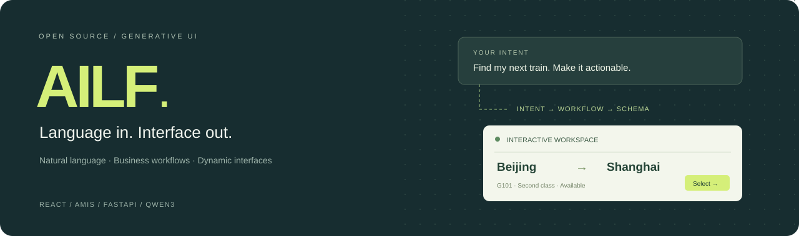
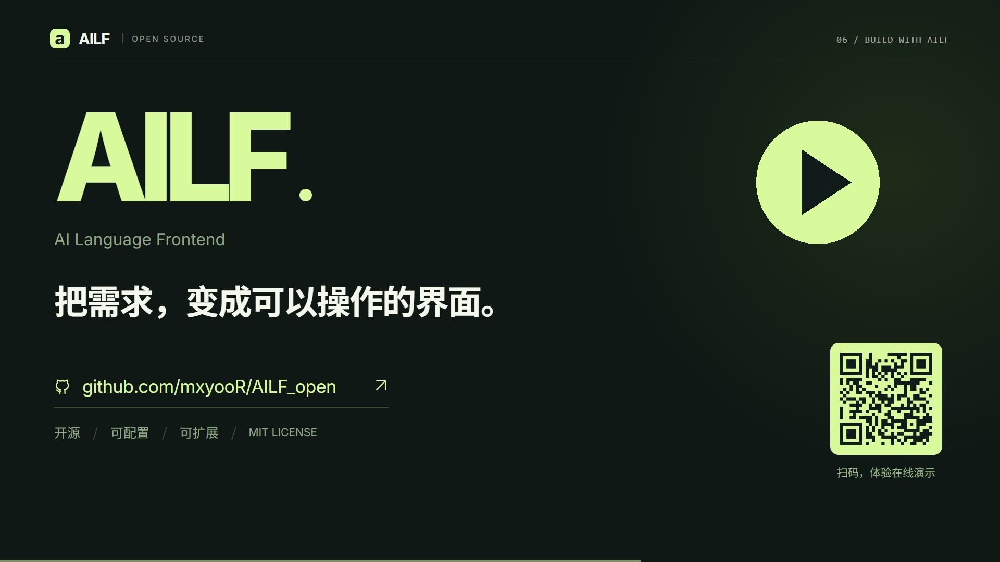
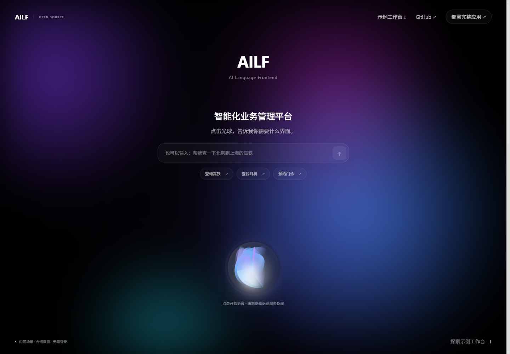
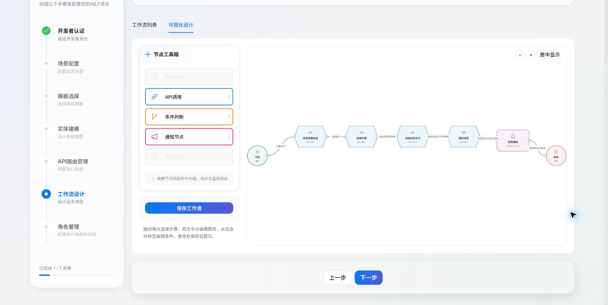
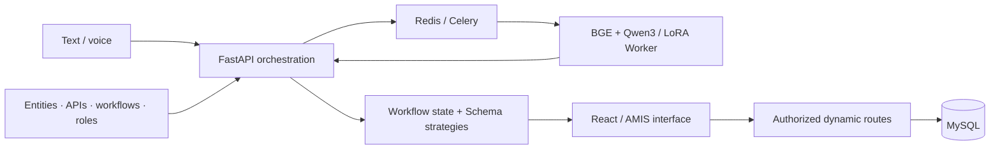

<div align="center">



# AILF · AI Language Frontend

**Turn a spoken or typed request into an interactive business interface.**

[](https://github.com/mxyooR/AILF_open/actions/workflows/ci.yml)
[](LICENSE)


[中文](README_zh.md) · **English** · [Live demo](https://mxyooR.github.io/AILF_open/) · [Architecture](docs/ARCHITECTURE.md) · [Deployment](docs/DEPLOYMENT.md)

</div>

AILF connects natural language, configured business APIs and workflows, and [AMIS](https://github.com/baidu/amis) interfaces. A developer defines the business model; a user describes a task; the system selects an API or workflow, extracts fields, and assembles the interface for the next action.

> “Find a high-speed train from Beijing to Shanghai, with a second-class seat.”
>
> Request → candidate retrieval → intent selection → slot extraction → interactive form → workflow execution.

This repository is the public edition: application code, three business templates, training examples and scripts, and adapter configuration. **Model weights, local credentials, databases and uploaded files are excluded.** It is an engineering prototype; measured accuracy, latency and production-scale reliability are not claimed.

## AILF in 64 seconds

[](docs/assets/ailf-promo.mp4)

**[▶ Watch / download the product film](docs/assets/ailf-promo.mp4)** · 64 seconds · 1080p · 6.7 MB · Chinese narration and captions · [Subtitles](docs/assets/ailf-promo.zh.srt)

The film shows the public playground, its workflow editor, and the full application's processing path. Business footage uses preset intents and synthetic data; narration is AI-generated.

## See it before setting up a model

The `/demo` playground opens with the application's original Siri-style orb and animated aurora background. Type an example request or choose a railway, product or appointment preset; edit its form, select a result and inspect the AMIS Schema. Optional speech input uses the browser's recognition service.

The [workflow editor](docs/WORKFLOW_EDITOR.md) below it supports adding and editing nodes, connecting steps, setting conditions, saving and reloading page-local configuration, and read-only browsing.

**[Open the hosted playground →](https://mxyooR.github.io/AILF_open/)** · [Demo walkthrough](docs/DEMO.md)

```bash
git clone https://github.com/mxyooR/AILF_open.git
cd AILF_open
pnpm install --frozen-lockfile
pnpm dev
```

Open **http://localhost:3000/demo**. Requires Node.js 20+ and pnpm 10.13.1. If dependencies are already available locally, reuse that environment instead of installing another copy.

The demo uses **preset intents and synthetic data**. It demonstrates Schema rendering and interaction; the full application uses the inference Worker described below. No account, model download, API key or database is needed for the playground.



## What is implemented

| Capability | Implementation |
| --- | --- |
| Language-driven interfaces | Text input, browser speech recognition and optional local Whisper fallback; AMIS forms and result views |
| Business configuration | Scenario templates, entity modeling, dynamic routes, roles and a Butterfly workflow canvas |
| Context retrieval | BGE retrieval over business API/workflow candidates, followed by two-round Qwen3 + LoRA inference |
| Workflow execution | Persisted workflow sessions, node execution and Schema strategies for the current step |
| Server authorization | Role permissions, developer/user JWT sessions, refresh rotation and runtime route checks |
| Separate inference service | Celery + Redis queue, independent model Worker and a runtime monitoring page |
| Bounded command orchestration | Per-process concurrency and admission limits, task deadlines, expiring state and per-task polling credentials |
| Public demo | Three local scenarios, editable form conditions and an inspectable Schema |

The built-in templates are **railway ticketing, basic ecommerce and hospital management**. Other domains require configuration and validation. Payments, ticket issuance and appointments in the sample flows are business examples rather than integrations with real providers.

<details>
<summary>Developer workflow canvas</summary>



This screenshot shows an existing ticket-change workflow in the full application. The hosted playground uses separate synthetic configuration. [Node operations and save contract](docs/WORKFLOW_EDITOR.md).

</details>

## How it works



The command runtime bounds active orchestration and queued requests, returns HTTP 429 when full, and keeps expiring task state in Redis with a bounded local fallback. Polling requires a separate per-task credential whose digest is stored server-side. Model calls are delegated to Celery; the backend assembles schemas and advances workflow state. See [architecture and limits](docs/ARCHITECTURE.md) and the [async API contract](docs/ASYNC_COMMANDS.md).

## Run the full application

The full stack requires MySQL 8, Redis 7 and a separately configured inference Worker with compatible model weights. The frontend demo can be run independently.

```bash
# Generate unique local credentials; this creates an ignored .env.
python scripts/setup_env.py

# Start the application and data services.
docker compose up --build -d

# After placing model weights in the documented directories:
docker compose --profile inference up --build -d worker
```

| Entry | URL |
| --- | --- |
| Browser playground | http://localhost:3000/demo |
| Full application | http://localhost:3000 |
| Developer configuration | http://localhost:3000/config |
| Interactive API docs | http://localhost:5000/docs |

Read [deployment](docs/DEPLOYMENT.md) for manual setup, model files, GPU requirements and verification limits. Docker configuration is validated separately from running a full GPU-backed deployment.

## Project map

```text
frontend/src/demo/       Local public fixtures and demo transport
frontend/src/pages/      Application, demo and monitoring pages
frontend/src/components/developer/  Configuration UI and workflow canvas
backend/app/api/v1/      HTTP API
backend/app/services/    Orchestration, workflow execution and Schema strategies
backend/app/core/       Database, authorization, dynamic routes and model proxies
backend/app/templates/  Three business templates
celery_worker/          Independent model inference service
Model/                  Training scripts, datasets and adapter configuration
scripts/                Local setup and public-repository checks
docs/                   Architecture, deployment and validation notes
```

## Checks and contribution

```bash
pnpm typecheck
pnpm test
pnpm build
python -m unittest discover -s backend/tests/unit -v
python -m unittest discover -s scripts/tests -v
python scripts/check_public_repo.py
python scripts/check_public_repo.py --staged
```

The offline backend checks need `python-dotenv`. Legacy scripts under `backend/tests/` include service-dependent and mutating integration cases; they are not the offline test suite. See [contributing](CONTRIBUTING.md), [security](SECURITY.md), and the [documentation index](docs/README.md).

## License and acknowledgments

Application code is available under the [MIT License](LICENSE). Third-party assets and models retain their own licenses. Thanks to [AMIS](https://github.com/baidu/amis), [Qwen](https://github.com/QwenLM/Qwen3), [BGE](https://github.com/FlagOpen/FlagEmbedding), [Butterfly](https://github.com/alibaba/butterfly), [FastAPI](https://fastapi.tiangolo.com/), [Celery](https://docs.celeryq.dev/) and [React](https://react.dev/).
