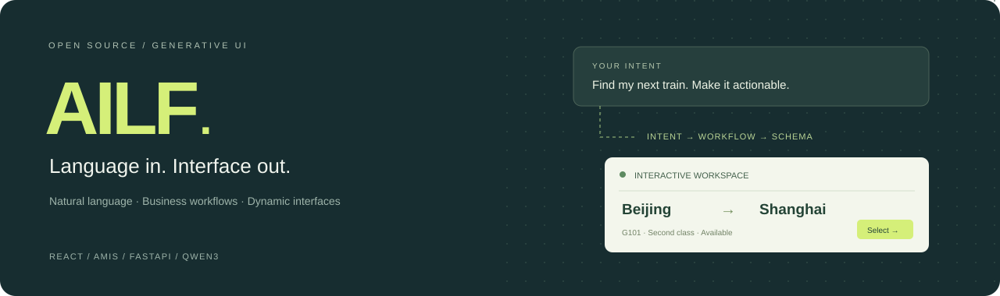
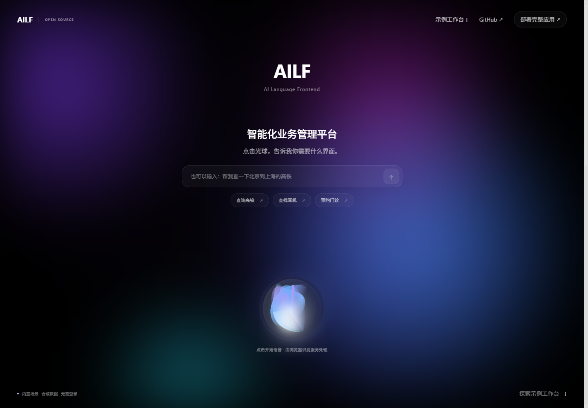
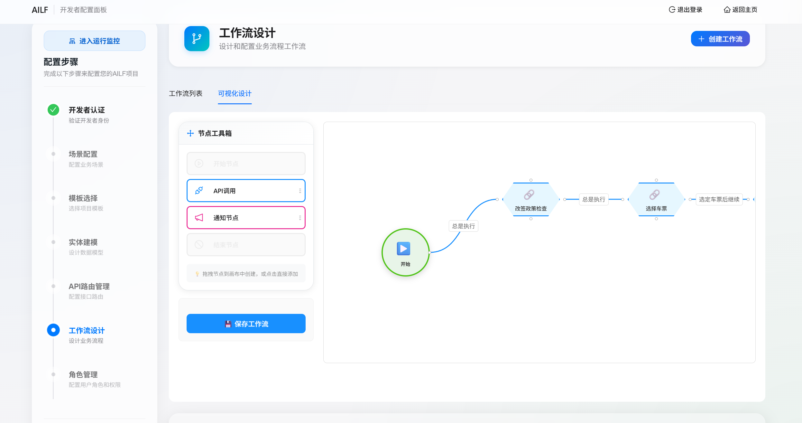
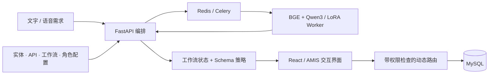

<div align="center">



# AILF · 自然语言驱动的动态业务界面

**说出需求，让界面接住。**

[](https://github.com/mxyooR/AILF_open/actions/workflows/ci.yml)
[](LICENSE)


**中文** · [English](README.md) · [在线体验](https://mxyooR.github.io/AILF_open/) · [架构设计](docs/ARCHITECTURE.md) · [部署指南](docs/DEPLOYMENT.md)

</div>

AILF 将自然语言、业务 API、工作流和 [AMIS](https://github.com/baidu/amis) 界面连接起来。开发者先定义业务模型，用户再通过文字或语音描述任务，系统选择 API 或工作流、提取字段，并组装当前步骤所需的交互界面。

> “帮我查一下北京到上海的高铁，选择二等座。”
>
> 需求 → 候选召回 → 意图选择 → 槽位提取 → 交互表单 → 工作流执行。

本仓库提供应用源码、三套业务模板、训练样例与脚本，以及适配器配置。**模型权重、本地凭据、数据库和上传文件均不随 Git 分发。** 当前定位为工程原型；准确率、时延和生产规模可靠性仍需要可复现的评测支撑。

## 先体验，再配置模型

`/demo` 保留应用原有的 Siri 风格光球与流动极光背景。输入一句示例需求，或选择铁路出行、商品检索、门诊预约，即可打开 AMIS 界面，修改条件、完成选择并查看 Schema。也可使用浏览器的语音识别服务输入需求。

**[打开在线演示 →](https://mxyooR.github.io/AILF_open/)** · [演示步骤](docs/DEMO.md)

```bash
git clone https://github.com/mxyooR/AILF_open.git
cd AILF_open
pnpm install --frozen-lockfile
pnpm dev
```

访问 **http://localhost:3000/demo**。需要 Node.js 20+ 和 pnpm 10.13.1；已有环境可直接复用，避免重复安装。

演示页使用**预置意图与合成数据**，用于体验 Schema 渲染和业务交互。完整应用通过独立 Worker 执行模型推理。体验演示无需账户、模型下载、API Key 或数据库。



## 已实现的能力

| 能力 | 实现方式 |
| --- | --- |
| 自然语言驱动界面 | 文字输入、浏览器语音识别与可选本地 Whisper 回退；AMIS 表单与结果视图 |
| 可视化业务配置 | 场景模板、实体建模、动态 API、角色配置与 Butterfly 工作流画布 |
| 业务上下文召回 | BGE 检索业务 API / 工作流候选，两轮 Qwen3 + LoRA 推理完成选择和槽位提取 |
| 工作流执行 | 持久化会话、节点执行与当前步骤的 Schema 生成策略 |
| 服务端权限校验 | 角色权限、开发者 / 用户 JWT 会话、刷新轮换和动态路由访问检查 |
| 独立推理服务 | Celery + Redis 队列、独立模型 Worker 与运行监控页面 |
| 有界异步编排 | 单进程并发与任务容量限制、任务超时、过期状态和独立轮询凭据 |
| 开源展示入口 | 三个本地演示场景、可修改的表单条件和可查看的 Schema |

内置模板为**铁路票务、基础电商、医院管理**。其他领域需要配置与验证；样例中的支付、出票和预约属于业务流程示例，尚未对接真实服务商。

<details>
<summary>展开查看可视化工作流设计器</summary>



</details>

## 系统如何工作



命令运行时限制活跃编排数与待处理总量，满载返回 HTTP 429；Redis 状态存储带过期时间，并提供容量受限的本地回退。每个任务使用独立查询凭据，服务端只保存摘要。模型调用通过 Celery 交给推理 Worker，后端负责组装 Schema 和推进工作流。实现入口和边界见[架构设计](docs/ARCHITECTURE.md)与[异步 API 约定](docs/ASYNC_COMMANDS.md)。

## 运行完整应用

完整应用需要 MySQL 8、Redis 7，以及已配置兼容模型权重的推理 Worker。前端演示可独立运行。

```bash
# 生成独立随机凭据，写入被 Git 忽略的 .env。
python scripts/setup_env.py

# 启动应用与数据服务。
docker compose up --build -d

# 按部署文档放置模型权重后，启动推理服务。
docker compose --profile inference up --build -d worker
```

| 入口 | 地址 |
| --- | --- |
| 浏览器演示 | http://localhost:3000/demo |
| 完整应用 | http://localhost:3000 |
| 开发者配置 | http://localhost:3000/config |
| 交互式 API 文档 | http://localhost:5000/docs |

手动部署、模型文件、GPU 要求和验证范围见[部署指南](docs/DEPLOYMENT.md)。Compose 配置检查与实际 GPU 部署是两项独立验证。

## 代码导航

```text
frontend/src/demo/       本地演示样例与请求处理
frontend/src/pages/      主应用、演示与运行监控页面
frontend/src/components/developer/  配置界面与工作流画布
backend/app/api/v1/      HTTP API
backend/app/services/    AI 编排、工作流执行和 Schema 策略
backend/app/core/        数据库、认证、动态路由和模型代理
backend/app/templates/  三套业务模板
celery_worker/          独立模型推理服务
Model/                  训练脚本、数据集和适配器配置
scripts/                本地配置生成与开源内容检查
docs/                   架构、部署和项目展示材料
```

## 验证与贡献

```bash
pnpm typecheck
pnpm test
pnpm build
python -m unittest discover -s backend/tests/unit -v
python -m unittest discover -s scripts/tests -v
python scripts/check_public_repo.py
python scripts/check_public_repo.py --staged
```

后端离线测试仅需 `python-dotenv`。`backend/tests/` 中的旧集成脚本依赖运行中的服务，部分会修改业务数据，不属于离线测试集。请参考[贡献指南](CONTRIBUTING.md)、[安全说明](SECURITY.md)和[文档索引](docs/README.md)。

## 许可与致谢

应用代码采用 [MIT License](LICENSE)。第三方素材和模型遵循各自许可。感谢 [AMIS](https://github.com/baidu/amis)、[Qwen](https://github.com/QwenLM/Qwen3)、[BGE](https://github.com/FlagOpen/FlagEmbedding)、[Butterfly](https://github.com/alibaba/butterfly)、[FastAPI](https://fastapi.tiangolo.com/)、[Celery](https://docs.celeryq.dev/) 与 [React](https://react.dev/)。
