# AILF (AI Language Frontend)

**如果你能直接说出需求，为什么还要点菜单？**

[](LICENSE)
[](https://www.python.org/)
[](https://fastapi.tiangolo.com/)
[](https://react.dev/)
[](https://github.com/QwenLM/Qwen3)

[English](README.md) · [中文](README_zh.md)

---

## AILF 是什么？

AILF 是一个基于大语言模型的**智能动态前端生成平台**。用户通过自然语言（语音或文字）表达需求，系统自动理解意图、填充槽位，并实时生成对应的业务操作界面。

**核心理念**：将传统软件中"先找功能再操作"的模式，转变为"先说需求再执行"。

**火车票只是其中一个例子。** AILF 是一个**通用的业务平台**，开箱即支持电商、医疗、酒店、银行、物流、教育等多个行业场景——你也可以零代码自定义任意业务场景。

想象一下，你只需说：
> *"我要买一张明天北京到上海的高铁票，早上出发的"*

系统自动完成：意图识别 → 槽位填充 → 表单生成 → 展示可选车次 → 用户确认 → 购票提交。

```
┌─────────────────────────────────────────────────────────────────┐
│  传统流程:  找到菜单 → 点击 → 点击 → 点击 → 提交                  │
│              (5-8 步, 45-120 秒)                                │
│                                                                  │
│  AILF 流程:  "我想要..." → AI 生成界面 → 完成                    │
│              (1 步, 2-5 秒)                                     │
└─────────────────────────────────────────────────────────────────┘
```

---

## 系统架构


| 图表 | 说明 |
|------|------|
| **数据集流程** | 模型训练数据管道 — 场景定义、数据生成、标注、验证 |
| **界面生成** | 前端架构 — AMIS Schema 生成、动态表单渲染、语音集成 |
| **服务端部署** | 后端基础设施 — FastAPI + Celery + Redis + MySQL 服务编排 |
| **工作流执行** | 状态机设计 — 工作流持久化、节点推进、检查点与恢复 |

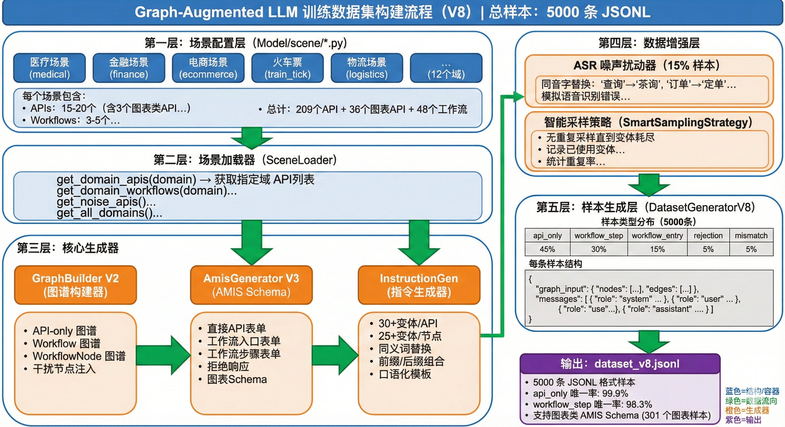
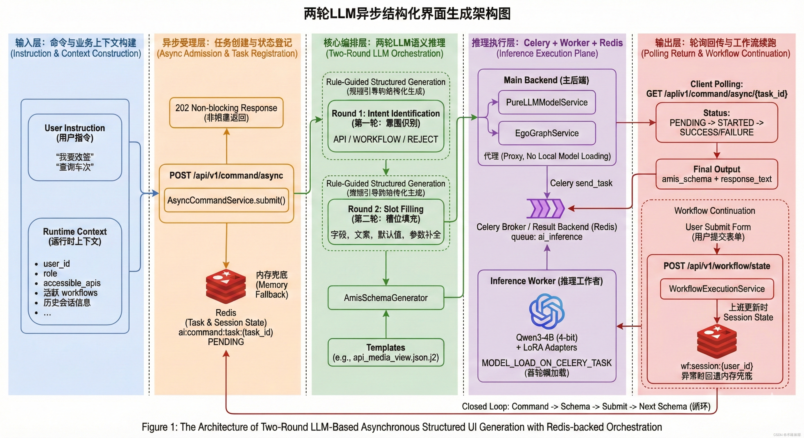
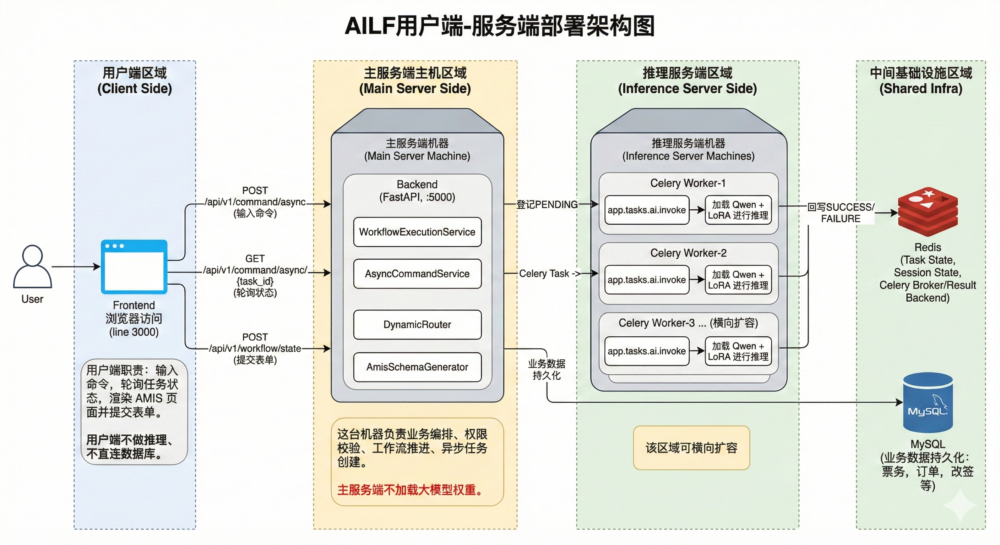
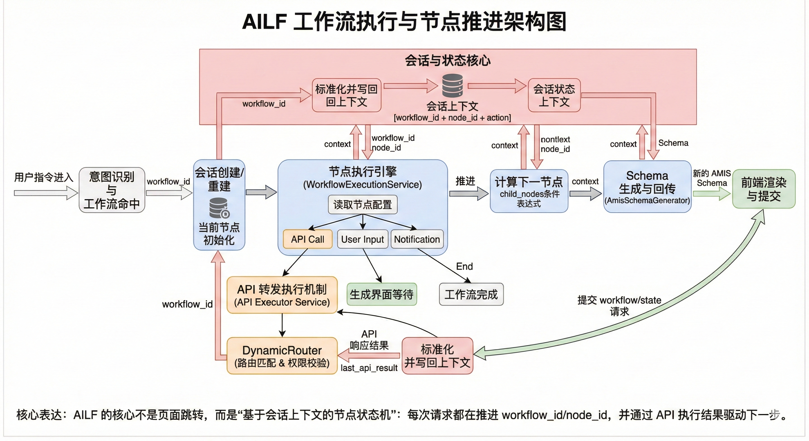

---

## 界面预览

| 登录页 | 工作流对话界面 |
|:------:|:------:|
| 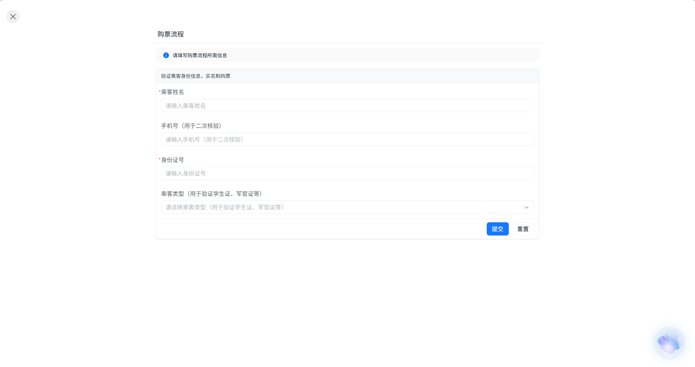 | 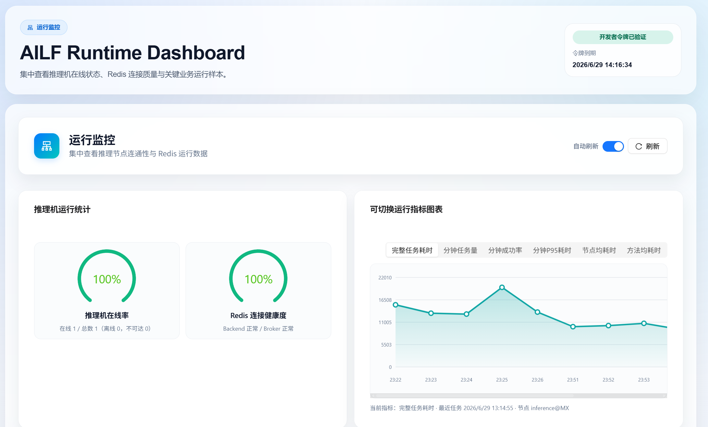 |

| 工作流表单 | 语音交互流程 |
|:------:|:------:|
| 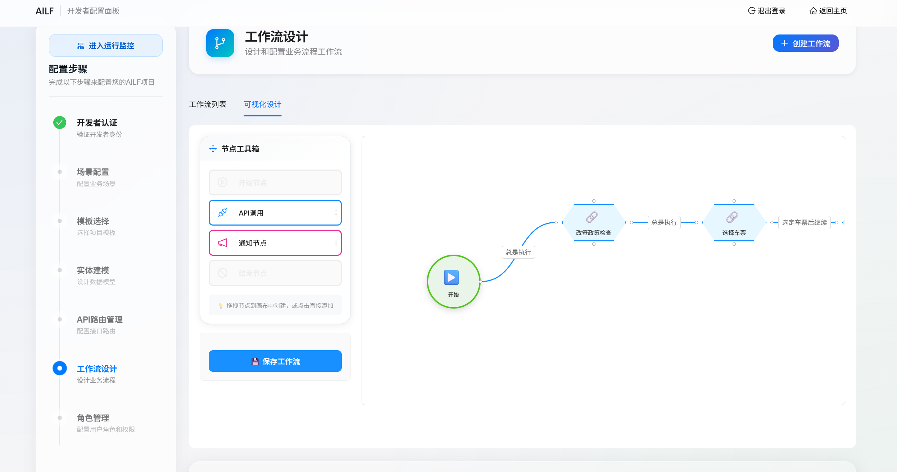 | 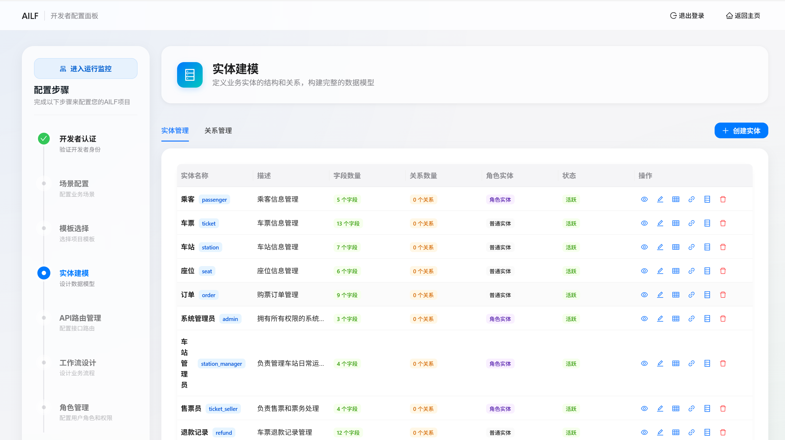 |

| 主界面 | 开发者配置面板 |
|:------:|:------:|
| 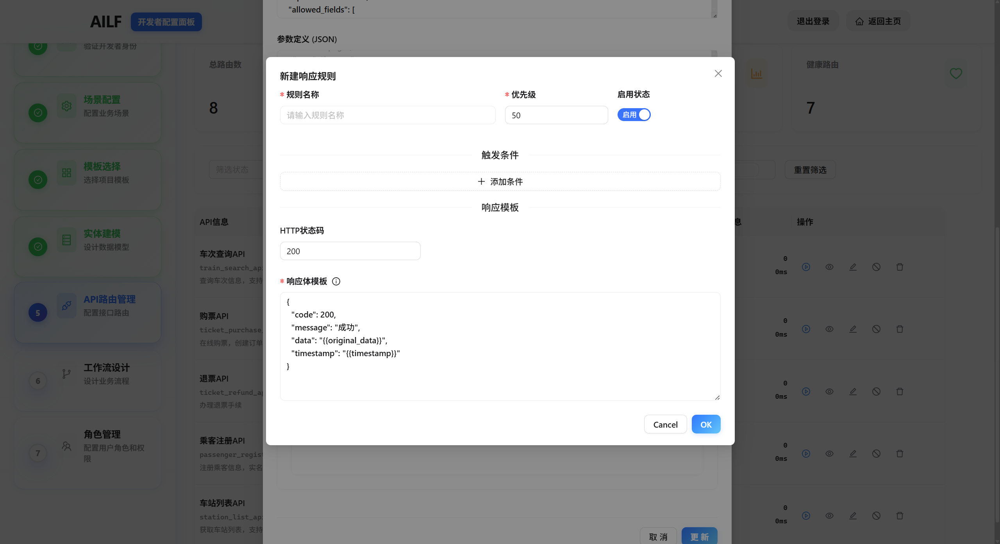 | 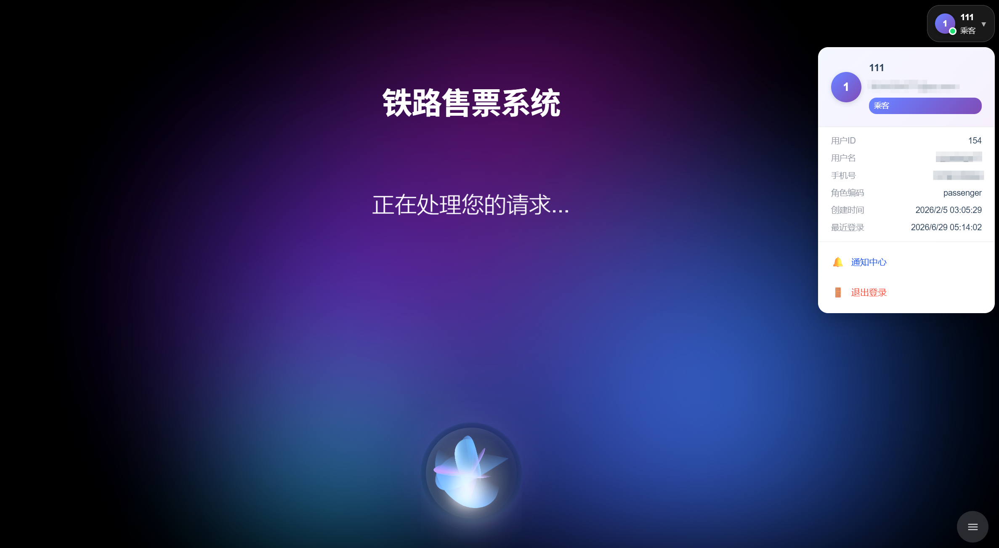 |

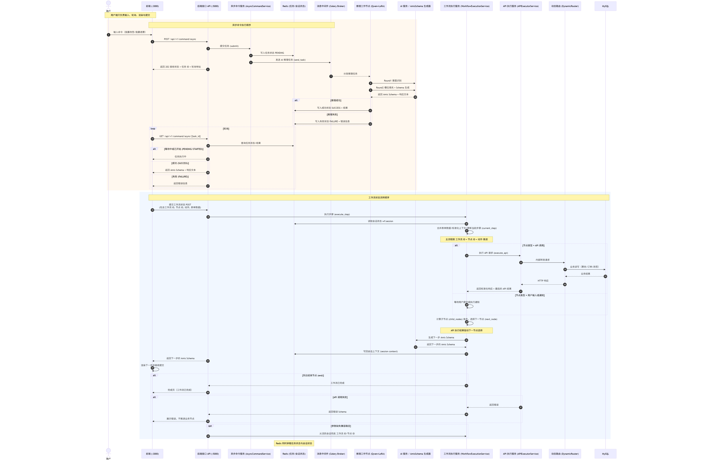

---

## 核心特性

| 特性 | 说明 |
|------|------|
| **多语言** | 支持多语言语音和文字输入 |
| **安全优先** | 多层防护：RBAC + JWT + 动态路由校验 + 审计日志 |
| **实时生成** | LLM 推理 + Schema 组装 + UI 渲染，秒级响应 |
| **零代码配置** | 开发者通过可视化面板配置实体、工作流、权限 |
| **语音交互** | 内置 Web Speech API，支持全程语音操作 |
| **多场景适配** | 内置票务、电商、医疗、酒店、银行、物流、教育等场景，并可零代码自定义任意业务场景 |

---

## 快速开始

### Docker 部署（推荐）

```bash
git clone https://github.com/mxyooR/AILF.git
cd AILF
docker-compose up -d
```

启动后访问：
- **用户端**: http://localhost:3000
- **开发者配置**: http://localhost:3000/config
- **API 文档**: http://localhost:5000/docs

### 手动安装

前置依赖：Python 3.10+、Node.js 18+、pnpm 8+、Redis 6+、MySQL 8.0+

```bash
# 1. 创建 Python 环境
conda create -n ailf_env python=3.11
conda activate ailf_env

# 2. 安装后端依赖
cd backend
cp .env.example .env
pip install -r requirements.txt

# 3. 初始化数据库
python scripts/init_db.py

# 4. 安装前端依赖
cd ../frontend
pnpm install

# 5. 启动服务（需要三个终端）
# 终端1 - 后端: cd backend && python main.py
# 终端2 - 前端: cd frontend && pnpm dev
# 终端3 - Worker: cd celery_worker && celery -A celery_app worker --loglevel=info
```

详细部署文档请参考 [docs/DEPLOYMENT.md](docs/DEPLOYMENT.md)。

---

## 两轮 LLM 架构

AILF 采用"意图识别 + 槽位填充"两轮 LLM 架构，通过 LoRA 微调实现领域适配。

```
第一轮：意图识别
┌─────────────────────────────────────────────────────┐
│  用户: "我要买一张明天北京到上海的高铁票"              │
│                                                     │
│  系统:                                              │
│    intent: WORKFLOW                                 │
│    candidate_workflows: [train_ticket]             │
│    confidence: 0.95                                 │
└─────────────────────────────────────────────────────┘

第二轮：槽位填充
┌─────────────────────────────────────────────────────┐
│  Scene: train_ticket                               │
│                                                     │
│  Slots:                                             │
│    date: 明天 (2024-XX-XX)                         │
│    departure: 北京                                   │
│    destination: 上海                                 │
│    time_range: 上午 (06:00-12:00)                  │
│    seat_type: 二等座                                 │
└─────────────────────────────────────────────────────┘
```

```bash
# 微调训练
cd Model
python train_pure_llm_v11.py
```

---

## 安全架构

| 层级 | 机制 | 说明 |
|------|------|------|
| **1. 候选约束** | 权限范围限制 | AI 仅在用户权限范围内的 API/工作流中做选择 |
| **2. 动态路由** | 运行时校验 | 端点与参数合法性在运行时验证 |
| **3. 授权** | RBAC 模型 | 基于角色的访问控制 |
| **4. 认证** | JWT 双 Token | Access + Refresh token 轮换 |
| **5. 会话治理** | 并发限制 | 最大会话数、吊销列表 |
| **6. 审计** | 结构化日志 | JSON 日志，敏感字段自动脱敏 |

---

## 配置指南

### 实体配置

```json
{
  "name": "train_ticket",
  "display_name": "火车票",
  "fields": [
    {"name": "departure", "type": "string", "label": "出发地", "required": true},
    {"name": "destination", "type": "string", "label": "目的地", "required": true},
    {"name": "date", "type": "date", "label": "出发日期", "required": true},
    {"name": "seat_type", "type": "enum", "label": "座位类型", "options": ["二等座", "一等座", "商务座"]}
  ]
}
```

### 工作流配置

```json
{
  "name": "train_ticket_purchase",
  "display_name": "购票流程",
  "steps": [
    {"step": 1, "name": "query_trains", "action": "查询车次", "entity": "train_ticket", "api_endpoint": "/api/trains/search"},
    {"step": 2, "name": "select_train", "action": "选择车次", "display": "table"},
    {"step": 3, "name": "confirm_order", "action": "确认订单", "form": "passenger_info"},
    {"step": 4, "name": "payment", "action": "支付", "api_endpoint": "/api/payment/create"}
  ]
}
```

### 权限配置

```json
{
  "roles": [
    {"name": "admin", "permissions": ["*"]},
    {"name": "user", "workflows": ["train_ticket_purchase"], "apis": ["/api/trains/*"]},
    {"name": "guest", "workflows": ["query_only"], "apis": ["/api/trains/search"]}
  ]
}
```

---

## 项目结构

```
AILF/
├── backend/              # FastAPI 后端
│   ├── app/
│   │   ├── api/v1/       # API 路由
│   │   ├── core/         # 核心模块（AI、Auth、动态路由）
│   │   ├── models/       # SQLAlchemy 模型
│   │   ├── schemas/      # Pydantic 模型
│   │   └── services/     # 业务逻辑
│   ├── scripts/          # 运维脚本
│   └── tests/            # 测试用例
├── frontend/             # React + AMIS 前端
├── celery_worker/        # 推理 Worker
├── Model/                # 训练相关
├── docs/                 # 文档
├── screenshots/          # 截图
├── docker-compose.yml    # Docker 编排
└── README.md
```

---

## 测试

```bash
cd backend
python -m pytest tests/
python -m pytest tests/ --cov=app --cov-report=html
```

---

## 常见问题

**Q: AILF 支持哪些 LLM 模型？**
A: 兼容任何 OpenAI API 接口的模型，包括 Qwen、Llama、GPT-4 等。

**Q: 意图识别的准确率如何？**
A: 使用 LoRA 微调后，意图识别任务达到 95%+ 的准确率。

**Q: 可以不使用语音输入吗？**
A: 可以，同时支持文字和语音输入，语音可随时关闭。

**Q: 如何添加新的业务场景？**
A: 在开发者配置面板中配置实体、工作流和权限，无需编写代码。

---

## 贡献指南

1. Fork 本仓库
2. 创建特性分支 (`git checkout -b feature/AmazingFeature`)
3. 提交更改 (`git commit -m 'feat: add amazing feature'`)
4. 推送到分支 (`git push origin feature/AmazingFeature`)
5. 创建 Pull Request

详情请阅读 [CONTRIBUTING.md](CONTRIBUTING.md)。

---

## 开源协议

本项目基于 [MIT License](LICENSE) 开源。

## 致谢

- [Baidu AMIS](https://aisuda.baidu.com/amis/zh/docs/index) — 低代码前端框架
- [Qwen3](https://github.com/QwenLM/Qwen3) — 阿里通义千问大语言模型
- [BGE](https://github.com/FlagOpen/FlagEmbedding) — 智源通用嵌入模型
- [FastAPI](https://fastapi.tiangolo.com/) — 高性能 Web 框架
- [Celery](https://docs.celeryq.dev/) — 异步任务队列
- [React](https://react.dev/) — 用于构建用户界面的 JavaScript 库
- [Docker](https://www.docker.com/) — 容器化平台
- [Butterfly](https://github.com/alibaba/butterfly) (MIT) — 节点式可视化编排组件库（工作流设计器前端参考）
- [LINUX DO](https://linux.do) — 活跃的开发者社区

## Star History

[](https://star-history.com/#mxyooR/AILF&Timeline)
