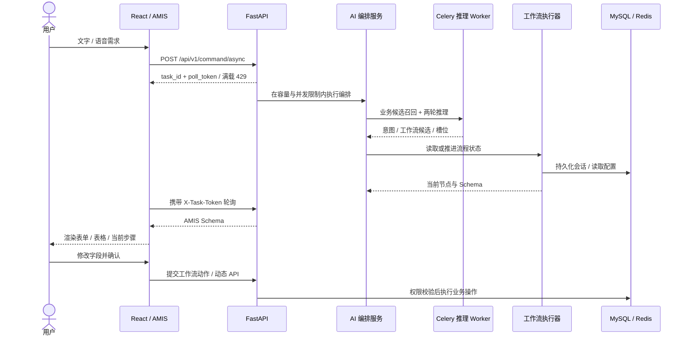
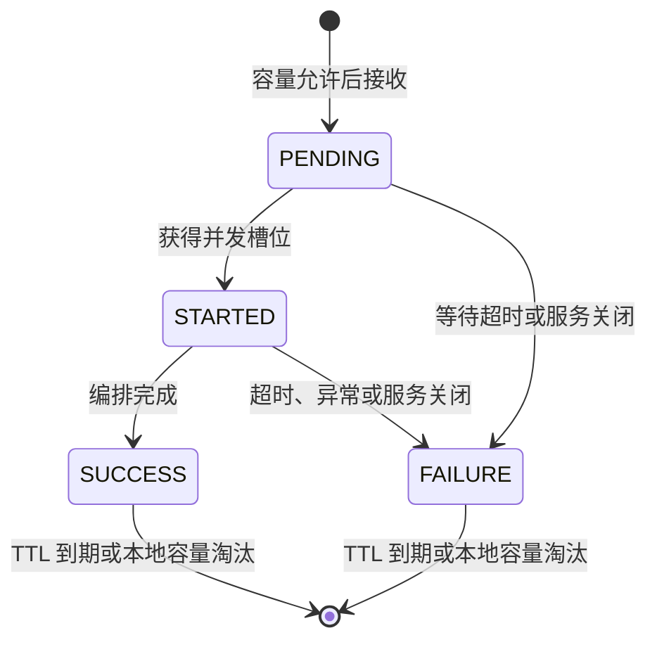

# AILF 架构设计

AILF 的核心是将「需求理解」与「业务执行」连接起来：业务配置定义可用能力，模型从候选中选择意图、提取槽位，服务端将当前流程状态转换为 AMIS Schema，浏览器负责渲染和交互。

## 两种运行方式

| | 浏览器演示 `/demo` | 完整应用 `/` |
| --- | --- | --- |
| 意图来源 | 三个预置示例 | Qwen3 + LoRA 推理 |
| 数据 | 浏览器内合成数据 | MySQL 中的业务实体 |
| 执行 | 本地请求处理器 | 服务端工作流与动态 API |
| 依赖 | 前端静态文件 | 前端、FastAPI、MySQL、Redis、推理 Worker、模型权重 |

演示复用原应用的 Siri 光球、极光背景和真实 AMIS 渲染器。文字 / 可选浏览器语音输入用固定关键词选择内置场景，再展示从 Schema 到可操作界面的过程。它没有连接模型、业务数据库或真实支付 / 预约服务。

## 完整链路

异步命令运行时负责 HTTP 入口的编排生命周期；模型服务通过 Celery RPC 委派给独立 Worker。两层分别控制请求编排和模型队列，命令本身不是可自动重放的持久化 Celery 作业。

## 有界命令运行时

将任务生命周期抽为独立的 `CommandRuntime`，通过注入异步处理器和状态存储测试它，无需加载模型、连接数据库或启动 Redis。HTTP 路由只负责上下文、响应与错误码，前端通过独立客户端处理提交和轮询。

| 机制 | 行为 | 代码证据 |
| --- | --- | --- |
| 容量与并发控制 | 默认每进程最多 64 个未完成任务，其中最多 2 个进入编排；超出容量返回 429，关闭中返回 503 | [运行时](../backend/app/core/command_runtime.py)、[路由](../backend/app/api/v1/ai.py) |
| 生命周期 | 跟踪任务引用，复制提交上下文，给排队和执行设置合计 540 秒的等待上限；关闭时取消并记录失败 | [运行时](../backend/app/core/command_runtime.py) |
| 状态存储 | 异步 Redis I/O；默认状态 TTL 为 3600 秒，轮询不续期；本地回退最多 1024 条，优先淘汰完成结果 | [状态存储](../backend/app/core/command_runtime.py)、[依赖组装](../backend/app/services/async_command_service.py) |
| 故障回退 | Redis 故障时使用本进程状态，并短暂冷却重试；慢读不能覆盖期间更新的本地结果 | [离线回归测试](../backend/tests/unit/test_command_runtime.py) |
| 查询隔离 | 每任务生成随机 `poll_token`，仅保存 SHA-256 摘要；通过请求头验证，缺失或错误凭据统一返回 404 | [API 约定](ASYNC_COMMANDS.md)、[前端客户端](../frontend/src/services/common/asyncCommand.ts) |
| 避免事件循环阻塞 | 将 BGE 召回的同步 Celery RPC 移入线程等待，异步 Redis 客户端负责任务状态 I/O | [AMIS 编排](../backend/app/services/ai_amis_service.py) |

这些默认值是可配置的资源保护策略，尚未通过压测得到吞吐量或时延提升数据。信号量约束活跃的 Python 编排；取消等待不会强制终止已经交给 Celery 的 GPU 作业或正在运行的底层线程，推理资源仍需由 Worker 并发数和队列策略控制。

并发与容量限制属于单进程。Redis 可以共享结果，但不能恢复重启前丢失的编排任务；本地回退也不跨实例共享。多实例下应使用共享 Redis，故障期间需要请求粘性或接受查询暂时不可用。更强的任务恢复能力需要将完整编排迁入持久化队列，并处理业务操作的幂等性。

## 关键设计与代码入口

| 设计 | 解决的问题 | 代码入口 |
| --- | --- | --- |
| 两轮推理 | 将 API / 工作流选择与字段提取分开，减少单次输出职责 | [模型服务](../celery_worker/model/pure_llm_model_service.py)、[训练脚本](../Model/train_pure_llm_v11.py) |
| 业务候选召回 | 从业务图谱中筛选与需求、当前节点相关的上下文 | [Ego Graph 服务](../celery_worker/model/ego_graph_service.py) |
| 独立推理 Worker | 后端编排和模型加载分离，支持单独配置计算环境 | [Worker 应用](../celery_worker/celery_app.py)、[任务](../celery_worker/ai_tasks.py) |
| 可测试的任务运行时 | 将并发、期限、状态和轮询凭据从 HTTP 与模型服务中分离 | [运行时](../backend/app/core/command_runtime.py)、[单元测试](../backend/tests/unit/test_command_runtime.py) |
| 工作流状态与 Schema 策略 | 将节点执行结果映射为下一步表单和结果视图 | [执行器](../backend/app/services/workflow_execution_service.py)、[会话服务](../backend/app/services/workflow_session_service.py)、[Schema 策略](../backend/app/services/schema_strategies/) |
| 运行时动态路由 | 将配置中的 API 映射到实体服务，并在请求时检查权限 | [动态路由](../backend/app/core/dynamic_router.py)、[权限服务](../backend/app/services/permission_service.py) |
| 双类型 JWT 会话 | 区分开发者与最终用户，管理刷新、并发会话与吊销 | [JWT](../backend/app/core/auth/jwt_handler.py)、[会话服务](../backend/app/services/token_session_service.py) |
| 可视化工作流 | 将业务流程编辑与执行逻辑连接 | [Butterfly 画布](../frontend/src/components/developer/workflow/WorkflowCanvas.tsx) |
| 本地展示入口 | 在没有模型和数据服务的环境中体验交互 | [示例 Schema 与本地请求](../frontend/src/demo/scenarios.ts)、[演示页](../frontend/src/pages/DemoPage.tsx) |

## 工程取舍与边界

- Schema 由后端策略与模板组装，结合模型输出；系统围绕已配置业务能力工作。
- AMIS 提供统一渲染协议，新增业务主要落在实体、API、权限与工作流配置；特殊组件和真实外部服务仍需开发。
- Redis 为会话和任务状态提供共享存储，部分服务有内存回退。进程重启恢复和多实例一致性需要结合部署方式测试。
- 权限过滤候选可以约束模型上下文，最终访问仍依赖服务端检查。模型输出校验与授权不可互相替代。
- 完整链路涉及数据库建表、业务写入和模型权重；离线单元测试与前端演示测试不覆盖这些集成行为。
- 任务入口有容量保护；面向用户 / IP 的请求限流、依赖升级、部署隔离、压力测试和系统化模型评测仍需完善。

较早的模块文档保留在文档目录中，可能描述旧实现；当前代码与本文所列入口优先。
