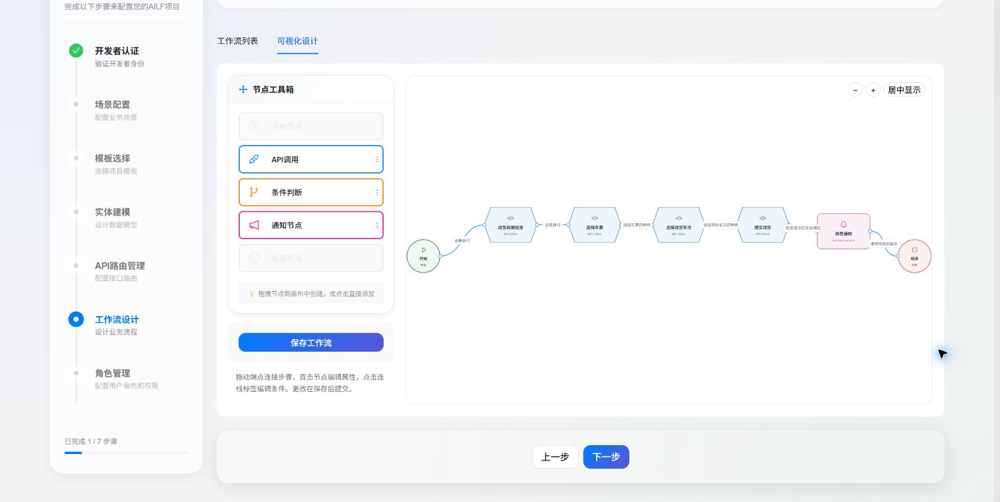
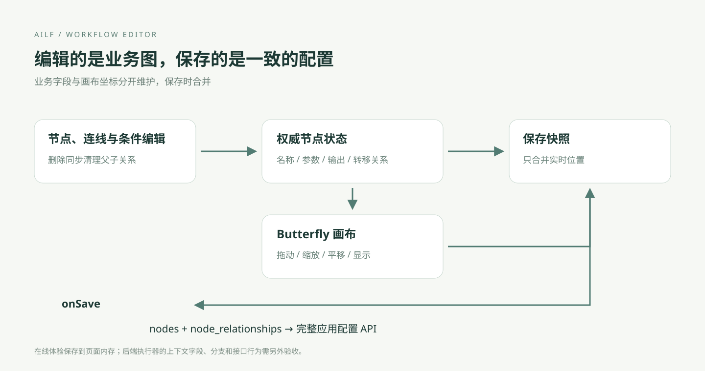
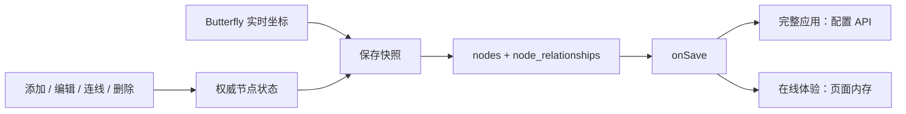

# 可视化工作流编辑器

工作流编辑器把业务步骤保存为节点、父子关系和转移条件。完整应用入口为 `/config` 的「工作流设计」；[在线体验](https://mxyooR.github.io/AILF_open/#workflow)提供同一画布组件的合成配置，保存仅在当前页面内生效。

## 节点与操作

| 节点 | 配置与作用 |
| --- | --- |
| 开始 | 声明流程入口与输入 |
| API 调用 | 选择已配置路由，填写方法、参数与输出字段 |
| 条件判断 | 在出边上配置比较条件，组织分支 |
| 通知 | 配置消息和消息类型 |
| 结束 | 声明结束步骤 |

从工具箱点击或拖入节点，双击节点编辑；键盘聚焦后按 Enter 或空格也可打开编辑器。拖动输出端点到另一个节点的输入端点创建连线；点击连线标签修改条件或删除连线。删除节点会同时清理入边、出边与相邻节点的关系。画布支持缩放和居中，只读模式保留浏览能力。

API 参数使用 `${department}` 或 `${lookup_result.total}` 形式引用上下文。参数 JSON 无效时显示错误并阻止保存。演示中的 `/demo/slots` 仅用于配置展示，不请求实际业务服务。

## 条件属于连线

条件节点的出边可设为「总是执行」或「表达式条件」。表达式使用单字段比较，例如 `total > 0`、`verified == true`，支持 `==`、`!=`、`>`、`<`、`>=`、`<=`；它不是 JavaScript 执行环境。

执行器按照 `child_nodes` 顺序选择第一个满足条件的出边，因此默认分支应放在条件分支之后。修改连线条件保持原顺序。后端同时兼容 `form_completed` 和旧条件节点内部的 `config.conditions`；表单完成标志由实际提交步骤产生，不能仅凭前端传值跳过步骤。

## 从画布到保存配置

画布实例负责显示与坐标；业务字段和关系由 React 内的节点状态维护。保存时只从画布合并位置，避免库内旧配置覆盖刚编辑的节点。`0` 是合法坐标，空图也是有效编辑结果；保存同时重建 `node_relationships`，与 `nodes` 保持一致。

外部切换工作流时，过期的异步响应会被忽略；画布重绘串行处理并合并连续更新。事件限定在所属画布内，避免页面存在多个画布时互相触发编辑或删除。

## 后端执行与验证

保存会保留节点的扩展配置和浮点坐标，重新生成父节点与关系视图。草稿允许未完成的图；启用时检查入口、终点、连线及可达性。运行时按实际节点 ID 推进，自动循环会停止并返回错误。

入口和后续表单都绑定工作流实例与当前节点。写接口等待提交，业务 API 失败时停留在失败节点，旧表单不能推进新实例。实体 API 与管理接口共用数据转换和事务规则。实现说明见[后端修复文档](BACKEND_RELIABILITY.md)，实际测试结果和模型验证边界见[验证记录](VALIDATION.md)。
