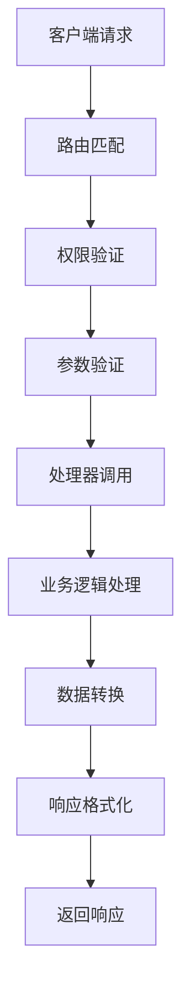
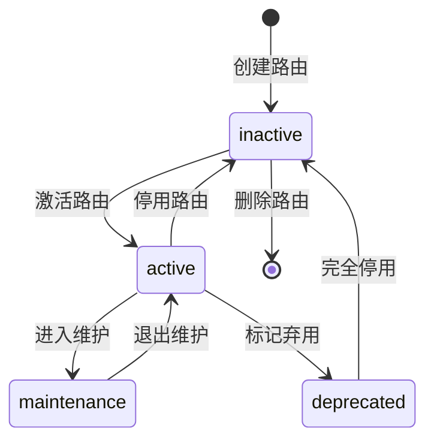

# API路由管理模块 完整文档

## 📋 概述

API路由管理模块是系统的核心组件，提供动态API路由的注册、管理、状态控制和监控功能。支持运行时动态添加、修改和删除API端点，实现灵活的业务逻辑处理和数据操作。

### 🎯 核心功能

1. **动态路由注册** - 运行时动态添加新的API端点
2. **路由生命周期管理** - 创建、更新、删除、激活、停用
3. **多种处理器支持** - 实体CRUD、自定义函数、代理转发、工作流等
4. **智能表单集成** - 自动为API生成对应的数据录入表单
5. **性能监控** - 调用统计、响应时间、成功率监控
6. **健康检查** - 实时监控API状态和性能指标
7. **权限控制** - 细粒度的API访问权限管理

---

## 🔧 API请求响应机制

### 📥 请求处理流程



### 📤 响应机制原理

#### 1. **统一响应格式**
所有API响应都遵循统一的JSON格式，确保客户端处理的一致性：

```json
{
  "code": "HTTP状态码对应的业务码",
  "message": "人类可读的消息描述",
  "data": "实际的响应数据",
  "meta": {
    "timestamp": "响应时间戳",
    "request_id": "请求唯一标识",
    "execution_time": "处理耗时(ms)",
    "api_version": "API版本"
  }
}
```

#### 2. **处理器响应机制**
不同类型的处理器有不同的响应生成方式：

- **实体CRUD处理器**：根据数据库操作结果生成标准化响应
- **自定义函数处理器**：执行用户定义的业务逻辑并返回结果
- **代理处理器**：转发外部API的响应并进行格式统一
- **工作流处理器**：返回工作流执行状态和结果
- **静态数据处理器**：返回预定义的静态数据

#### 3. **错误响应处理**
系统提供多层次的错误处理机制：

```json
{
  "code": 400,
  "message": "请求参数验证失败",
  "data": {
    "error_type": "validation_error",
    "details": {
      "field_errors": {
        "name": ["字段不能为空", "长度不能超过100个字符"],
        "email": ["邮箱格式不正确"]
      },
      "global_errors": ["业务规则验证失败"]
    },
    "suggestion": "请检查输入参数格式并重试"
  },
  "meta": {
    "error_code": "PARAM_VALIDATION_FAILED",
    "debug_info": "仅开发环境显示的调试信息"
  }
}
```

---

## 🔗 API 端点详细文档

### 1. 动态注册新的API路由

**POST** `/api/routes/register`

#### 📝 功能描述
动态注册新的API路由，支持多种处理器类型和业务逻辑。注册成功后，新的API端点立即可用，并自动生成对应的数据录入表单。

#### 🔄 处理流程
1. **接收注册请求** → 验证请求参数格式
2. **检查路由冲突** → 确保端点和方法组合唯一
3. **验证处理器配置** → 检查处理器类型和配置参数
4. **创建数据库记录** → 保存路由配置到数据库
5. **注册动态路由** → 将路由添加到FastAPI应用
6. **生成关联表单** → 自动创建数据录入表单
7. **返回注册结果** → 包含路由ID和访问信息

#### 📋 请求参数

**Content-Type:** `application/json`

**请求头：**
```http
Authorization: Bearer <developer_token>
Content-Type: application/json
```

**请求体结构：**
```json
{
  "api_id": "string (必填)",
  "name": "string (必填)", 
  "endpoint": "string (必填)",
  "method": "string (必填)",
  "description": "string (可选)",
  "auth_required": "boolean (默认true)",
  "handler": {
    "type": "string (必填)",
    "config": "object (必填)"
  },
  "parameters": [
    {
      "name": "string",
      "type": "string", 
      "location": "query|path|body|header",
      "required": "boolean",
      "description": "string",
      "validation": "object"
    }
  ],
  "responses": {
    "status_code": {
      "description": "string",
      "response_schema": "object",
      "headers": "object"
    }
  },
  "form_config": {
    "auto_generate": "boolean (默认true)",
    "fields": "array (可选)",
    "layout": "object (可选)"
  }
}
```

#### 🎛️ 处理器类型详解

##### 1. **实体CRUD处理器** (`entity_crud`)
**用途**：对数据库实体进行标准的增删改查操作

**配置示例**：
```json
{
  "type": "entity_crud",
  "config": {
    "entity": "product",
    "operation": "create|read|update|delete|list",
    "allowed_fields": ["name", "price", "description"],
    "validation_rules": {
      "name": "required|max:100",
      "price": "required|numeric|min:0"
    },
    "relations": ["category", "brand"],
    "permissions": {
      "create": ["admin", "staff"],
      "update": ["admin"],
      "delete": ["admin"]
    }
  }
}
```

**响应原理**：
- **CREATE**：插入新记录，返回创建的实体数据
- **READ**：根据ID查询单条记录
- **UPDATE**：更新指定记录，返回更新后的数据
- **DELETE**：删除记录，返回删除确认信息
- **LIST**：分页查询，返回列表和分页信息

##### 2. **自定义函数处理器** (`custom_function`)
**用途**：执行用户定义的业务逻辑函数

**配置示例**：
```json
{
  "type": "custom_function",
  "config": {
    "function": "calculate_discount",
    "module": "business.pricing",
    "parameters": {
      "product_id": "required",
      "customer_level": "optional"
    },
    "cache_ttl": 300,
    "timeout": 30
  }
}
```

**响应原理**：
- 动态导入指定模块的函数
- 传入请求参数并执行函数
- 将函数返回值包装成标准响应格式

##### 3. **代理转发处理器** (`proxy`)
**用途**：转发请求到外部API服务

**配置示例**：
```json
{
  "type": "proxy",
  "config": {
    "target_url": "https://api.external-service.com",
    "timeout": 30,
    "headers": {
      "Authorization": "Bearer external-token"
    },
    "transform_request": true,
    "transform_response": true,
    "cache_response": false
  }
}
```

**响应原理**：
- 构造外部API请求
- 转发请求并获取响应
- 转换响应格式为系统标准格式

##### 4. **工作流处理器** (`workflow`)
**用途**：触发和管理业务工作流

**配置示例**：
```json
{
  "type": "workflow",
  "config": {
    "workflow_id": "order_processing",
    "trigger_mode": "sync|async",
    "input_mapping": {
      "order_data": "$.body",
      "user_id": "$.user.id"
    },
    "output_mapping": {
      "result": "$.workflow.result",
      "status": "$.workflow.status"
    }
  }
}
```

**响应原理**：
- 根据输入映射准备工作流数据
- 启动工作流实例
- 根据触发模式返回同步结果或异步任务ID

##### 5. **静态数据处理器** (`static_data`)
**用途**：返回预定义的静态数据

**配置示例**：
```json
{
  "type": "static_data",  
  "config": {
    "data": {
      "categories": [
        {"id": 1, "name": "电子产品"},
        {"id": 2, "name": "服装鞋帽"}
      ]
    },
    "cache": true,
    "cache_ttl": 3600
  }
}
```

**响应原理**：
- 直接返回配置中的静态数据
- 支持缓存以提高性能

#### 📝 请求示例

**创建商品管理API**：
```bash
curl -X POST "http://localhost:5000/api/routes/register" \
  -H "Content-Type: application/json" \
  -H "Authorization: Bearer dev_token_2024" \
  -d '{
    "api_id": "product_create_api",
    "name": "商品创建API",
    "endpoint": "/api/products",
    "method": "POST",
    "description": "创建新的商品记录，支持商品基本信息和分类",
    "auth_required": true,
    "handler": {
      "type": "entity_crud",
      "config": {
        "entity": "product",
        "operation": "create",
        "allowed_fields": ["name", "price", "description", "category_id", "brand_id"],
        "validation_rules": {
          "name": "required|max:100|unique:products,name",
          "price": "required|numeric|min:0.01",
          "category_id": "required|exists:categories,id"
        },
        "relations": ["category", "brand"],
        "auto_timestamps": true
      }
    },
    "parameters": [
      {
        "name": "name",
        "type": "string",
        "location": "body",
        "required": true,
        "description": "商品名称",
        "validation": {
          "max_length": 100,
          "min_length": 2
        }
      },
      {
        "name": "price",
        "type": "number",
        "location": "body", 
        "required": true,
        "description": "商品价格",
        "validation": {
          "min": 0.01,
          "max": 999999.99
        }
      },
      {
        "name": "description",
        "type": "string",
        "location": "body",
        "required": false,
        "description": "商品描述"
      },
      {
        "name": "category_id",
        "type": "integer",
        "location": "body",
        "required": true,
        "description": "商品分类ID"
      }
    ],
    "responses": {
      "201": {
        "description": "商品创建成功",
        "response_schema": {
          "type": "object",
          "properties": {
            "code": {"type": "integer", "example": 201},
            "message": {"type": "string", "example": "商品创建成功"},
            "data": {
              "type": "object",
              "properties": {
                "product": {
                  "type": "object",
                  "properties": {
                    "id": {"type": "string"},
                    "name": {"type": "string"},
                    "price": {"type": "number"},
                    "description": {"type": "string"},
                    "category": {"type": "object"},
                    "created_at": {"type": "string", "format": "datetime"}
                  }
                }
              }
            }
          }
        }
      },
      "400": {
        "description": "请求参数验证失败",
        "response_schema": {
          "type": "object",
          "properties": {
            "code": {"type": "integer", "example": 400},
            "message": {"type": "string", "example": "参数验证失败"},
            "data": {
              "type": "object",
              "properties": {
                "error_type": {"type": "string"},
                "details": {"type": "object"}
              }
            }
          }
        }
      }
    },
    "form_config": {
      "auto_generate": true,
      "layout": {
        "type": "grid",
        "columns": 2,
        "spacing": 16
      },
      "sections": [
        {
          "title": "基本信息",
          "fields": ["name", "category_id"]
        },
        {
          "title": "详细信息", 
          "fields": ["price", "description"]
        }
      ]
    }
  }'
```

#### ✅ 成功响应 (201 Created)

**响应说明**：
- **为什么这样响应**：API注册成功，系统已创建路由记录并注册到FastAPI应用
- **怎么响应**：返回完整的路由信息、自动生成的表单配置、访问URL等

```json
{
  "code": 201,
  "message": "API路由注册成功",
  "data": {
    "route": {
      "id": "route_20240120_001",
      "api_id": "product_create_api",
      "name": "商品创建API",
      "endpoint": "/api/products",
      "method": "POST",
      "description": "创建新的商品记录，支持商品基本信息和分类",
      "auth_required": true,
      "status": "active",
      "handler": {
        "type": "entity_crud",
        "config": {
          "entity": "product",
          "operation": "create",
          "allowed_fields": ["name", "price", "description", "category_id", "brand_id"]
        }
      },
      "access_url": "http://localhost:5000/api/products",
      "created_at": "2024-01-20T10:00:00.000Z",
      "updated_at": "2024-01-20T10:00:00.000Z"
    },
    "form": {
      "id": "form_20240120_001",
      "name": "商品创建表单",
      "entity": "product",
      "field_count": 4,
      "auto_generated": true,
      "access_url": "/config#forms/form_20240120_001"
    },
    "statistics": {
      "total_routes": 1,
      "active_routes": 1,
      "total_forms": 1
    }
  },
  "meta": {
    "timestamp": "2024-01-20T10:00:00.000Z",
    "request_id": "req_20240120_001",
    "execution_time": 234,
    "api_version": "1.0.0"
  }
}
```

#### ❌ 错误响应示例

**冲突响应 (409 Conflict)**：
```json
{
  "code": 409,
  "message": "API路由已存在",
  "data": {
    "error_type": "route_conflict",
    "details": {
      "conflicting_endpoint": "/api/products",
      "conflicting_method": "POST",
      "existing_route": {
        "id": "route_existing_001",
        "api_id": "existing_product_api",
        "created_at": "2024-01-19T15:30:00.000Z"
      }
    },
    "suggestion": "请使用不同的端点路径或HTTP方法，或者更新现有路由"
  },
  "meta": {
    "error_code": "ROUTE_CONFLICT",
    "timestamp": "2024-01-20T10:00:00.000Z"
  }
}
```

**验证失败响应 (400 Bad Request)**：
```json
{
  "code": 400,
  "message": "请求参数验证失败",
  "data": {
    "error_type": "validation_error",
    "details": {
      "field_errors": {
        "api_id": ["API ID不能为空", "API ID只能包含字母、数字和下划线"],
        "endpoint": ["端点路径必须以/开头"],
        "handler.config.entity": ["实体名称不存在"]
      },
      "global_errors": [
        "处理器类型与配置不匹配"
      ]
    },
    "suggestion": "请检查输入参数格式并重试"
  },
  "meta": {
    "error_code": "VALIDATION_FAILED",
    "timestamp": "2024-01-20T10:00:00.000Z"
  }
}
```

---

### 2. 获取当前已注册的所有API路由

**GET** `/api/routes`

#### 📝 功能描述
获取系统中所有已注册的API路由列表，支持多维度筛选、排序和分页。提供路由的基本信息、状态统计和性能指标。

#### 🔄 处理流程
1. **解析查询参数** → 处理筛选条件和分页参数
2. **构建数据库查询** → 根据筛选条件构建SQL查询
3. **执行分页查询** → 查询路由列表和总数统计
4. **加载关联数据** → 加载关联的表单和统计信息
5. **计算性能指标** → 汇总调用统计和响应时间
6. **格式化响应数据** → 构建标准响应格式

#### 📋 请求参数

**请求头：**
```http
Authorization: Bearer <developer_token>
```

**查询参数：**
| 参数 | 类型 | 必填 | 描述 | 示例 |
|------|------|------|------|------|
| status | string | 否 | 筛选路由状态 | active, inactive, maintenance |
| method | string | 否 | 筛选HTTP方法 | GET, POST, PUT, DELETE |
| handler_type | string | 否 | 筛选处理器类型 | entity_crud, custom_function |
| entity | string | 否 | 筛选关联实体 | product, order, user |
| search | string | 否 | 搜索路由名称或描述 | 商品, API |
| page | integer | 否 | 页码，默认1 | 1, 2, 3 |
| limit | integer | 否 | 每页数量，默认20，最大100 | 10, 20, 50 |
| sort | string | 否 | 排序字段 | name, created_at, call_count |
| order | string | 否 | 排序方向 | asc, desc |
| include_stats | boolean | 否 | 是否包含统计信息，默认true | true, false |
| include_forms | boolean | 否 | 是否包含关联表单，默认true | true, false |

#### 📝 请求示例

**基础查询**：
```bash
curl -X GET "http://localhost:5000/api/routes" \
  -H "Authorization: Bearer dev_token_2024"
```

**高级筛选查询**：
```bash
curl -X GET "http://localhost:5000/api/routes?status=active&method=POST&handler_type=entity_crud&entity=product&page=1&limit=10&sort=call_count&order=desc&include_stats=true" \
  -H "Authorization: Bearer dev_token_2024"
```

#### ✅ 成功响应 (200 OK)

**响应说明**：
- **为什么这样响应**：查询成功，返回符合条件的路由列表和相关统计信息
- **怎么响应**：按指定条件筛选和排序，分页返回数据，包含完整的路由信息和性能指标

```json
{
  "code": 200,
  "message": "获取API路由列表成功",
  "data": {
    "routes": [
      {
        "id": "route_20240120_001",
        "api_id": "product_create_api",
        "name": "商品创建API",
        "endpoint": "/api/products",
        "method": "POST",
        "description": "创建新的商品记录，支持商品基本信息和分类",
        "auth_required": true,
        "status": "active",
        "handler": {
          "type": "entity_crud",
          "display_name": "实体CRUD操作",
          "config": {
            "entity": "product",
            "operation": "create"
          }
        },
        "statistics": {
          "call_count": 156,
          "successful_calls": 148,
          "failed_calls": 8,
          "success_rate": 94.87,
          "avg_response_time": 189,
          "last_called": "2024-01-20T11:30:00.000Z"
        },
        "performance": {
          "health_status": "healthy",
          "response_time_trend": "stable",
          "error_rate": 5.13
        },
        "associated_forms": [
          {
            "id": "form_20240120_001",
            "name": "商品创建表单",
            "field_count": 4,
            "created_at": "2024-01-20T10:00:00.000Z"
          }
        ],
        "created_at": "2024-01-20T10:00:00.000Z",
        "updated_at": "2024-01-20T10:00:00.000Z"
      },
      {
        "id": "route_20240120_002",
        "api_id": "product_list_api",
        "name": "商品列表API",
        "endpoint": "/api/products",
        "method": "GET",
        "description": "获取商品列表，支持分页和筛选",
        "auth_required": true,
        "status": "active",
        "handler": {
          "type": "entity_crud",
          "display_name": "实体CRUD操作",
          "config": {
            "entity": "product", 
            "operation": "list"
          }
        },
        "statistics": {
          "call_count": 2341,
          "successful_calls": 2298,
          "failed_calls": 43,
          "success_rate": 98.16,
          "avg_response_time": 145,
          "last_called": "2024-01-20T11:45:00.000Z"
        },
        "performance": {
          "health_status": "healthy",
          "response_time_trend": "improving",
          "error_rate": 1.84
        },
        "associated_forms": [],
        "created_at": "2024-01-20T09:30:00.000Z",
        "updated_at": "2024-01-20T09:30:00.000Z"
      }
    ],
    "pagination": {
      "page": 1,
      "limit": 10,
      "total": 25,
      "pages": 3,
      "has_next": true,
      "has_prev": false,
      "next_page": 2,
      "prev_page": null
    },
    "summary": {
      "total_routes": 25,
      "active_routes": 23,
      "inactive_routes": 2,
      "maintenance_routes": 0,
      "total_calls": 45678,
      "total_successful_calls": 44123,
      "overall_success_rate": 96.6,
      "avg_response_time": 178,
      "healthy_routes": 22,
      "warning_routes": 1,
      "unhealthy_routes": 0
    },
    "filters_applied": {
      "status": "active",
      "method": "POST",
      "handler_type": "entity_crud",
      "entity": "product"
    }
  },
  "meta": {
    "timestamp": "2024-01-20T12:00:00.000Z",
    "request_id": "req_20240120_002",
    "execution_time": 45,
    "api_version": "1.0.0",
    "cache_hit": false
  }
}
```

---

### 3. 更新已注册的API路由

**PUT** `/api/routes/{route_id}`

#### 📝 功能描述
更新已注册的API路由配置，包括处理器配置、参数定义、响应格式等。支持部分更新，不影响路由的调用统计和历史数据。

#### 🔄 处理流程
1. **验证路由存在** → 检查路由ID是否有效
2. **检查更新权限** → 验证是否有权限更新该路由
3. **验证更新数据** → 检查更新参数的有效性
4. **备份当前配置** → 保存更新前的配置用于回滚
5. **更新数据库记录** → 保存新的配置信息
6. **更新动态路由** → 重新注册路由到FastAPI应用
7. **更新关联表单** → 根据新配置更新关联表单
8. **返回更新结果** → 包含更新后的完整配置

#### 📋 请求参数

**路径参数：**
| 参数 | 类型 | 必填 | 描述 |
|------|------|------|------|
| route_id | string | 是 | 路由唯一标识符 |

**请求头：**
```http
Authorization: Bearer <developer_token>
Content-Type: application/json
```

**请求体：** (支持部分更新)
```json
{
  "name": "string (可选)",
  "description": "string (可选)",
  "auth_required": "boolean (可选)",
  "handler": {
    "type": "string (可选)",
    "config": "object (可选)"
  },
  "parameters": "array (可选)",
  "responses": "object (可选)",
  "form_config": {
    "auto_generate": "boolean (可选)",
    "fields": "array (可选)",
    "layout": "object (可选)"
  }
}
```

#### 📝 请求示例

```bash
curl -X PUT "http://localhost:5000/api/routes/route_20240120_001" \
  -H "Content-Type: application/json" \
  -H "Authorization: Bearer dev_token_2024" \
  -d '{
    "name": "商品创建API（增强版）",
    "description": "创建新的商品记录，支持批量导入和自动分类",
    "handler": {
      "config": {
        "entity": "product",
        "operation": "create",
        "allowed_fields": ["name", "price", "description", "category_id", "brand_id", "tags"],
        "validation_rules": {
          "name": "required|max:100|unique:products,name",
          "price": "required|numeric|min:0.01",
          "category_id": "required|exists:categories,id",
          "tags": "array|max:5"
        },
        "auto_categorize": true,
        "batch_import": true
      }
    },
    "parameters": [
      {
        "name": "tags",
        "type": "array",
        "location": "body",
        "required": false,
        "description": "商品标签数组",
        "validation": {
          "max_items": 5
        }
      }
    ]
  }'
```

#### ✅ 成功响应 (200 OK)

**响应说明**：
- **为什么这样响应**：路由更新成功，配置已生效并重新注册到系统
- **怎么响应**：返回更新后的完整路由信息，包含变更历史和影响的关联对象

```json
{
  "code": 200,
  "message": "API路由更新成功",
  "data": {
    "route": {
      "id": "route_20240120_001",
      "api_id": "product_create_api",
      "name": "商品创建API（增强版）",
      "endpoint": "/api/products",
      "method": "POST",
      "description": "创建新的商品记录，支持批量导入和自动分类",
      "auth_required": true,
      "status": "active",
      "handler": {
        "type": "entity_crud",
        "config": {
          "entity": "product",
          "operation": "create",
          "allowed_fields": ["name", "price", "description", "category_id", "brand_id", "tags"],
          "auto_categorize": true,
          "batch_import": true
        }
      },
      "created_at": "2024-01-20T10:00:00.000Z",
      "updated_at": "2024-01-20T12:30:00.000Z"
    },
    "changes": {
      "updated_fields": ["name", "description", "handler.config"],
      "added_parameters": ["tags"],
      "removed_parameters": [],
      "affected_forms": [
        {
          "id": "form_20240120_001",
          "name": "商品创建表单",
          "updated": true,
          "new_field_count": 5
        }
      ]
    },
    "version": {
      "current": 2,
      "previous": 1,
      "backup_id": "backup_20240120_001_v1"
    }
  },
  "meta": {
    "timestamp": "2024-01-20T12:30:00.000Z",
    "request_id": "req_20240120_003",
    "execution_time": 167,
    "api_version": "1.0.0"
  }
}
```

---

### 4. 删除已注册的API路由

**DELETE** `/api/routes/{route_id}`

#### 📝 功能描述
删除指定的API路由注册。删除前会检查路由的使用情况，支持强制删除和安全删除两种模式。

#### 🔄 处理流程
1. **验证路由存在** → 检查路由ID是否有效
2. **检查删除权限** → 验证是否有权限删除该路由
3. **安全性检查** → 检查路由是否正在被使用
4. **处理关联对象** → 处理关联的表单和数据
5. **从系统注销** → 从FastAPI应用中移除路由
6. **删除数据库记录** → 删除或标记删除数据库记录
7. **清理缓存** → 清理相关的缓存数据
8. **返回删除结果** → 包含删除确认和影响说明

#### 📋 请求参数

**路径参数：**
| 参数 | 类型 | 必填 | 描述 |
|------|------|------|------|
| route_id | string | 是 | 路由唯一标识符 |

**查询参数：**
| 参数 | 类型 | 必填 | 描述 |
|------|------|------|------|
| force | boolean | 否 | 是否强制删除，默认false |
| backup | boolean | 否 | 是否备份配置，默认true |
| cascade | boolean | 否 | 是否级联删除关联对象，默认false |

**请求头：**
```http
Authorization: Bearer <developer_token>
```

#### 📝 请求示例

**安全删除**：
```bash
curl -X DELETE "http://localhost:5000/api/routes/route_20240120_001" \
  -H "Authorization: Bearer dev_token_2024"
```

**强制删除**：
```bash
curl -X DELETE "http://localhost:5000/api/routes/route_20240120_001?force=true&cascade=true" \
  -H "Authorization: Bearer dev_token_2024"
```

#### ✅ 成功响应 (200 OK)

**响应说明**：
- **为什么这样响应**：路由删除成功，已从系统中完全移除
- **怎么响应**：返回删除确认信息、备份位置、清理的关联对象等详细信息

```json
{
  "code": 200,
  "message": "API路由删除成功",
  "data": {
    "deleted_route": {
      "id": "route_20240120_001",
      "api_id": "product_create_api",
      "name": "商品创建API（增强版）",
      "endpoint": "/api/products",
      "method": "POST",
      "deleted_at": "2024-01-20T13:00:00.000Z"
    },
    "cleanup_summary": {
      "route_unregistered": true,
      "database_record_deleted": true,
      "cache_cleared": true,
      "associated_forms_handled": 1,
      "backup_created": true
    },
    "affected_objects": {
      "forms": [
        {
          "id": "form_20240120_001",
          "name": "商品创建表单",
          "action": "deleted",
          "backup_id": "form_backup_20240120_001"
        }
      ],
      "data_records": 0,
      "cache_keys": ["route:product_create_api", "stats:route_20240120_001"]
    },
    "backup": {
      "id": "backup_20240120_001_final",
      "location": "/backups/routes/backup_20240120_001_final.json",
      "size": "2.4KB",
      "retention_days": 30
    }
  },
  "meta": {
    "timestamp": "2024-01-20T13:00:00.000Z",
    "request_id": "req_20240120_004",
    "execution_time": 89,
    "api_version": "1.0.0"
  }
}
```

#### ⚠️ 警告响应 (409 Conflict)

**响应说明**：
- **为什么这样响应**：路由正在被使用，无法安全删除
- **怎么响应**：提供详细的使用情况说明和建议的处理方案

```json
{
  "code": 409,
  "message": "无法删除正在使用的API路由",
  "data": {
    "error_type": "route_in_use",
    "details": {
      "active_connections": 3,
      "recent_calls": 45,
      "last_call": "2024-01-20T12:58:00.000Z",
      "dependent_forms": [
        {
          "id": "form_20240120_001",
          "name": "商品创建表单",
          "last_used": "2024-01-20T12:55:00.000Z"
        }
      ]
    },
    "suggestions": [
      "先停用路由（POST /api/routes/{route_id}/deactivate）",
      "等待当前请求完成后再删除",
      "使用force=true参数强制删除",
      "考虑使用维护模式而不是删除"
    ]
  },
  "meta": {
    "error_code": "ROUTE_IN_USE",
    "timestamp": "2024-01-20T13:00:00.000Z"
  }
}
```

---

### 5. 激活API路由

**POST** `/api/routes/{route_id}/activate`

#### 📝 功能描述
激活指定的API路由，使其可以接收和处理请求。激活过程包括健康检查、依赖验证和性能预热。

#### 🔄 处理流程
1. **验证路由状态** → 检查路由是否可以被激活
2. **依赖性检查** → 验证处理器和数据源是否可用
3. **健康检查** → 执行路由健康检查
4. **注册到系统** → 将路由注册到FastAPI应用
5. **性能预热** → 预加载缓存和初始化连接
6. **更新状态** → 更新数据库中的路由状态
7. **通知监控** → 通知监控系统路由已激活

#### 📋 请求参数

**路径参数：**
| 参数 | 类型 | 必填 | 描述 |
|------|------|------|------|
| route_id | string | 是 | 路由唯一标识符 |

**查询参数：**
| 参数 | 类型 | 必填 | 描述 |
|------|------|------|------|
| health_check | boolean | 否 | 是否执行健康检查，默认true |
| warm_up | boolean | 否 | 是否执行预热，默认true |

**请求头：**
```http
Authorization: Bearer <developer_token>
```

#### 📝 请求示例

```bash
curl -X POST "http://localhost:5000/api/routes/route_20240120_001/activate?health_check=true&warm_up=true" \
  -H "Authorization: Bearer dev_token_2024"
```

#### ✅ 成功响应 (200 OK)

**响应说明**：
- **为什么这样响应**：路由激活成功，已经可以接收请求
- **怎么响应**：返回激活后的路由状态、健康检查结果、预热信息等

```json
{
  "code": 200,
  "message": "API路由激活成功",
  "data": {
    "route": {
      "id": "route_20240120_001",
      "api_id": "product_create_api",
      "name": "商品创建API（增强版）",
      "endpoint": "/api/products",
      "method": "POST",
      "status": "active",
      "activated_at": "2024-01-20T13:30:00.000Z"
    },
    "activation_details": {
      "health_check": {
        "status": "passed",
        "checks": [
          {"name": "database_connection", "status": "ok", "response_time": 15},
          {"name": "entity_validation", "status": "ok", "response_time": 8},
          {"name": "handler_initialization", "status": "ok", "response_time": 23}
        ],
        "total_time": 46
      },
      "warm_up": {
        "status": "completed",
        "actions": [
          {"name": "cache_preload", "status": "ok", "items_loaded": 150},
          {"name": "connection_pool", "status": "ok", "connections_initialized": 5},
          {"name": "validation_rules_compile", "status": "ok", "rules_compiled": 4}
        ],
        "total_time": 123
      },
      "dependencies": {
        "entity_product": "available",
        "database_connection": "healthy",
        "validation_service": "ready"
      }
    },
    "access_info": {
      "url": "http://localhost:5000/api/products",
      "method": "POST",
      "auth_required": true,
      "rate_limit": "100 requests/minute",
      "documentation": "/docs#/Products/create_product"
    }
  },
  "meta": {
    "timestamp": "2024-01-20T13:30:00.000Z",
    "request_id": "req_20240120_005",
    "execution_time": 169,
    "api_version": "1.0.0"
  }
}
```

---

### 6. 停用API路由

**POST** `/api/routes/{route_id}/deactivate`

#### 📝 功能描述
停用指定的API路由，使其不再接收新的请求。支持优雅停用和立即停用两种模式。

#### 🔄 处理流程
1. **验证路由状态** → 检查路由是否可以被停用
2. **处理活跃请求** → 等待或终止正在处理的请求
3. **从系统注销** → 从FastAPI应用中移除路由
4. **更新状态** → 更新数据库中的路由状态
5. **清理资源** → 清理缓存和连接
6. **通知监控** → 通知监控系统路由已停用

#### 📋 请求参数

**路径参数：**
| 参数 | 类型 | 必填 | 描述 |
|------|------|------|------|
| route_id | string | 是 | 路由唯一标识符 |

**查询参数：**
| 参数 | 类型 | 必填 | 描述 |
|------|------|------|------|
| graceful | boolean | 否 | 是否优雅停用，默认true |
| timeout | integer | 否 | 等待超时时间(秒)，默认30 |

**请求头：**
```http
Authorization: Bearer <developer_token>
```

#### 📝 请求示例

```bash
curl -X POST "http://localhost:5000/api/routes/route_20240120_001/deactivate?graceful=true&timeout=30" \
  -H "Authorization: Bearer dev_token_2024"
```

#### ✅ 成功响应 (200 OK)

```json
{
  "code": 200,
  "message": "API路由停用成功",
  "data": {
    "route": {
      "id": "route_20240120_001",
      "api_id": "product_create_api",
      "name": "商品创建API（增强版）",
      "endpoint": "/api/products",
      "method": "POST",
      "status": "inactive",
      "deactivated_at": "2024-01-20T14:00:00.000Z"
    },
    "deactivation_details": {
      "mode": "graceful",
      "active_requests_handled": 2,
      "wait_time": 15,
      "cleanup_actions": [
        {"name": "route_unregister", "status": "ok"},
        {"name": "cache_clear", "status": "ok", "items_cleared": 150},
        {"name": "connections_close", "status": "ok", "connections_closed": 3}
      ]
    },
    "final_statistics": {
      "total_lifetime_calls": 1847,
      "successful_calls": 1798,
      "failed_calls": 49,
      "final_success_rate": 97.34,
      "avg_response_time": 167
    }
  },
  "meta": {
    "timestamp": "2024-01-20T14:00:00.000Z",
    "request_id": "req_20240120_006",
    "execution_time": 15234
  }
}
```

---

### 7. 获取API路由状态

**GET** `/api/routes/{route_id}/status`

#### 📝 功能描述
获取指定API路由的详细状态信息，包括调用统计、性能指标、健康状态和实时监控数据。

#### 🔄 处理流程
1. **查询路由信息** → 获取路由基本信息和配置
2. **统计调用数据** → 汇总历史调用记录和统计信息
3. **计算性能指标** → 分析响应时间、成功率等指标
4. **健康状态评估** → 评估路由的健康状态
5. **实时监控数据** → 获取当前的实时监控数据
6. **趋势分析** → 分析性能趋势和异常情况

#### 📋 请求参数

**路径参数：**
| 参数 | 类型 | 必填 | 描述 |
|------|------|------|------|
| route_id | string | 是 | 路由唯一标识符 |

**查询参数：**
| 参数 | 类型 | 必填 | 描述 |
|------|------|------|------|
| period | string | 否 | 统计周期 | 1h, 24h, 7d, 30d |
| include_trends | boolean | 否 | 是否包含趋势分析，默认true |
| include_errors | boolean | 否 | 是否包含错误详情，默认true |

**请求头：**
```http
Authorization: Bearer <developer_token>
```

#### 📝 请求示例

```bash
curl -X GET "http://localhost:5000/api/routes/route_20240120_001/status?period=24h&include_trends=true&include_errors=true" \
  -H "Authorization: Bearer dev_token_2024"
```

#### ✅ 成功响应 (200 OK)

**响应说明**：
- **为什么这样响应**：成功获取路由状态，提供全面的监控和分析数据
- **怎么响应**：返回多维度的状态信息，包括实时数据、历史统计、性能指标和健康评估

```json
{
  "code": 200,
  "message": "获取API路由状态成功",
  "data": {
    "route": {
      "id": "route_20240120_001",
      "api_id": "product_create_api",
      "name": "商品创建API（增强版）",
      "endpoint": "/api/products",
      "method": "POST",
      "status": "active",
      "uptime": "4h 30m",
      "last_health_check": "2024-01-20T14:25:00.000Z"
    },
    "statistics": {
      "period": "24h",
      "total_calls": 1847,
      "successful_calls": 1798,
      "failed_calls": 49,
      "success_rate": 97.34,
      "error_rate": 2.66,
      "avg_response_time": 167,
      "min_response_time": 89,
      "max_response_time": 2340,
      "median_response_time": 145,
      "p95_response_time": 289,
      "p99_response_time": 567,
      "last_called": "2024-01-20T14:28:00.000Z",
      "calls_per_hour": 77,
      "peak_hour_calls": 134,
      "peak_hour": "2024-01-20T11:00:00.000Z"
    },
    "performance": {
      "health_status": "healthy",
      "health_score": 96,
      "response_time_trend": "stable",
      "load_level": "normal",
      "cpu_usage": 12.3,
      "memory_usage": 45.7,
      "disk_io": "low",
      "network_io": "normal"
    },
    "error_analysis": {
      "recent_errors": [
        {
          "timestamp": "2024-01-20T14:15:00.000Z",
          "error_type": "ValidationError",
          "message": "价格字段验证失败",
          "count": 3,
          "client_ip": "192.168.1.100"
        },
        {
          "timestamp": "2024-01-20T13:45:00.000Z",
          "error_type": "DatabaseTimeout",
          "message": "数据库连接超时",
          "count": 1,
          "duration": 30000
        }
      ],
      "error_categories": {
        "validation_errors": 28,
        "database_errors": 12,
        "timeout_errors": 6,
        "permission_errors": 3
      },
      "top_error_sources": [
        {"client_ip": "192.168.1.100", "count": 15},
        {"client_ip": "192.168.1.101", "count": 8}
      ]
    },
    "trends": {
      "hourly_calls": [89, 92, 78, 134, 112, 95, 87, 94, 101, 89, 76, 88],
      "hourly_success_rate": [98.9, 97.8, 98.7, 95.5, 96.4, 98.1, 99.1, 97.9, 96.8, 98.2, 98.9, 97.6],
      "hourly_avg_response_time": [145, 167, 134, 189, 178, 156, 123, 167, 189, 145, 134, 156],
      "prediction": {
        "next_hour_calls": 92,
        "next_hour_success_rate": 97.8,
        "confidence": 0.85
      }
    },
    "dependencies": {
      "database": {
        "status": "healthy",
        "response_time": 15,
        "connection_pool": "8/10 active"
      },
      "cache": {
        "status": "healthy",
        "hit_rate": 85.6,
        "memory_usage": "234MB/1GB"
      },
      "external_apis": []
    },
    "alerts": [
      {
        "level": "warning",
        "message": "响应时间在过去30分钟内略有上升",
        "triggered_at": "2024-01-20T14:00:00.000Z"
      }
    ]
  },
  "meta": {
    "timestamp": "2024-01-20T14:30:00.000Z",
    "request_id": "req_20240120_007",
    "execution_time": 89,
    "api_version": "1.0.0",
    "data_freshness": "real-time"
  }
}
```

---

### 8. 检查所有API路由健康状态

**GET** `/api/routes/health`

#### 📝 功能描述
检查所有已注册API路由的健康状态，提供系统整体运行情况概览和性能监控dashboard。

#### 🔄 处理流程
1. **扫描所有路由** → 获取系统中所有注册的路由
2. **并行健康检查** → 对每个路由执行健康检查
3. **汇总系统指标** → 计算系统整体性能指标
4. **识别问题路由** → 识别有问题的路由和潜在风险
5. **生成建议** → 根据分析结果生成优化建议
6. **格式化报告** → 生成详细的健康状态报告

#### 📋 请求参数

**查询参数：**
| 参数 | 类型 | 必填 | 描述 |
|------|------|------|------|
| detailed | boolean | 否 | 是否返回详细信息，默认false |
| include_inactive | boolean | 否 | 是否包含非活跃路由，默认false |
| format | string | 否 | 响应格式 | json, summary |

**请求头：**
```http
Authorization: Bearer <developer_token>
```

#### 📝 请求示例

```bash
curl -X GET "http://localhost:5000/api/routes/health?detailed=true&include_inactive=false" \
  -H "Authorization: Bearer dev_token_2024"
```

#### ✅ 成功响应 (200 OK)

**响应说明**：
- **为什么这样响应**：健康检查完成，提供系统整体健康状况和详细分析
- **怎么响应**：返回系统级的健康摘要、各路由的详细状态、问题分析和优化建议

```json
{
  "code": 200,
  "message": "API路由健康检查完成",
  "data": {
    "overall_status": "healthy",
    "health_score": 94,
    "summary": {
      "total_routes": 25,
      "active_routes": 23,
      "inactive_routes": 2,
      "healthy_routes": 20,
      "warning_routes": 3,
      "unhealthy_routes": 0,
      "maintenance_routes": 2
    },
    "system_metrics": {
      "total_requests_24h": 45678,
      "successful_requests_24h": 44123,
      "failed_requests_24h": 1555,
      "overall_success_rate": 96.59,
      "overall_error_rate": 3.41,
      "avg_response_time": 178,
      "median_response_time": 145,
      "p95_response_time": 456,
      "total_uptime": "99.8%",
      "active_connections": 234,
      "requests_per_second": 12.5
    },
    "route_status": [
      {
        "id": "route_20240120_001",
        "api_id": "product_create_api",
        "name": "商品创建API",
        "endpoint": "/api/products",
        "method": "POST",
        "status": "active",
        "health": "healthy",
        "health_score": 96,
        "success_rate": 97.34,
        "avg_response_time": 167,
        "last_check": "2024-01-20T14:25:00.000Z",
        "uptime": "4h 30m"
      },
      {
        "id": "route_20240120_002",
        "api_id": "order_process_api",
        "name": "订单处理API",
        "endpoint": "/api/orders/process",
        "method": "POST",
        "status": "active",
        "health": "warning",
        "health_score": 78,
        "success_rate": 89.5,
        "avg_response_time": 2340,
        "last_check": "2024-01-20T14:25:00.000Z",
        "uptime": "6h 15m",
        "issues": [
          "响应时间超过阈值",
          "错误率略高于正常水平"
        ]
      },
      {
        "id": "route_20240120_003",
        "api_id": "user_notification_api",
        "name": "用户通知API",
        "endpoint": "/api/notifications",
        "method": "POST",
        "status": "active",
        "health": "healthy",
        "health_score": 98,
        "success_rate": 99.2,
        "avg_response_time": 89,
        "last_check": "2024-01-20T14:25:00.000Z",
        "uptime": "2d 14h"
      }
    ],
    "performance_analysis": {
      "top_performers": [
        {
          "route_id": "route_20240120_003",
          "metric": "success_rate",
          "value": 99.2
        },
        {
          "route_id": "route_20240120_001",
          "metric": "response_time",
          "value": 167
        }
      ],
      "problem_routes": [
        {
          "route_id": "route_20240120_002",
          "issues": ["high_response_time", "increased_error_rate"],
          "severity": "warning",
          "impact": "medium"
        }
      ],
      "resource_usage": {
        "cpu_utilization": 35.6,
        "memory_utilization": 67.8,
        "database_connections": "45/100",
        "cache_hit_rate": 87.3
      }
    },
    "recommendations": [
      {
        "priority": "high",
        "category": "performance",
        "description": "优化订单处理API的数据库查询，考虑添加索引或查询缓存",
        "affected_routes": ["route_20240120_002"],
        "estimated_improvement": "30-40% 响应时间减少"
      },
      {
        "priority": "medium",
        "category": "monitoring",
        "description": "为高流量API增加更细粒度的监控告警",
        "affected_routes": ["route_20240120_001", "route_20240120_003"],
        "benefit": "更早发现潜在问题"
      },
      {
        "priority": "low",
        "category": "optimization",
        "description": "考虑为静态数据API启用长期缓存",
        "affected_routes": ["route_20240120_005"],
        "benefit": "减少数据库负载"
      }
    ],
    "alerts": [
      {
        "level": "warning",
        "message": "订单处理API响应时间持续上升",
        "route_id": "route_20240120_002",
        "triggered_at": "2024-01-20T13:45:00.000Z",
        "duration": "45 minutes"
      }
    ],
    "trends": {
      "overall_health_trend": "stable",
      "success_rate_trend": "slightly_improving",
      "response_time_trend": "stable",
      "error_rate_trend": "decreasing"
    }
  },
  "meta": {
    "timestamp": "2024-01-20T14:30:00.000Z",
    "request_id": "req_20240120_008",
    "execution_time": 1234,
    "api_version": "1.0.0",
    "check_duration": "2.3 seconds",
    "next_auto_check": "2024-01-20T14:35:00.000Z"
  }
}
```

---

## 📊 监控和分析

### 🎯 性能指标

#### 响应时间分级
- **优秀** (< 100ms): 绿色指示
- **良好** (100-300ms): 黄色指示  
- **一般** (300-1000ms): 橙色指示
- **较慢** (1000-3000ms): 红色指示
- **超慢** (> 3000ms): 深红色指示

#### 成功率分级
- **优秀** (> 99%): A级
- **良好** (95-99%): B级
- **一般** (90-95%): C级
- **较差** (85-90%): D级
- **糟糕** (< 85%): F级

#### 健康状态判断标准
```json
{
  "healthy": {
    "success_rate": "> 95%",
    "avg_response_time": "< 500ms",
    "error_rate": "< 5%",
    "uptime": "> 99%"
  },
  "warning": {
    "success_rate": "85-95%",
    "avg_response_time": "500-2000ms", 
    "error_rate": "5-15%",
    "uptime": "95-99%"
  },
  "unhealthy": {
    "success_rate": "< 85%",
    "avg_response_time": "> 2000ms",
    "error_rate": "> 15%",
    "uptime": "< 95%"
  }
}
```

---

## 🔧 路由状态管理

### 📊 路由状态说明

| 状态 | 描述 | 行为 | 转换条件 |
|------|------|------|----------|
| **active** | 活跃状态 | 正常接收和处理请求 | 手动激活或自动激活 |
| **inactive** | 非活跃状态 | 不接收请求，返回404 | 手动停用或系统停用 |
| **maintenance** | 维护状态 | 返回503维护中提示 | 手动设置维护模式 |
| **deprecated** | 已弃用状态 | 接收请求但返回弃用警告 | 版本升级或API淘汰 |
| **testing** | 测试状态 | 仅限测试环境访问 | 新API测试阶段 |

### 🔄 状态转换流程



---

## 🚨 错误处理机制

### 📋 错误分类和处理

#### 1. **客户端错误 (4xx)**

**400 Bad Request - 请求参数错误**
```json
{
  "code": 400,
  "message": "请求参数验证失败",
  "data": {
    "error_type": "validation_error",
    "details": {
      "field_errors": {
        "name": ["字段不能为空"],
        "price": ["必须是正数"]
      }
    }
  }
}
```

**401 Unauthorized - 认证失败**
```json
{
  "code": 401,
  "message": "认证失败，请检查Token",
  "data": {
    "error_type": "authentication_error",
    "details": {
      "reason": "invalid_token",
      "expired_at": "2024-01-20T10:00:00.000Z"
    }
  }
}
```

**403 Forbidden - 权限不足**
```json
{
  "code": 403,
  "message": "权限不足，无法访问该资源",
  "data": {
    "error_type": "permission_error", 
    "details": {
      "required_permissions": ["route:create"],
      "user_permissions": ["route:read"]
    }
  }
}
```

**404 Not Found - 资源不存在**
```json
{
  "code": 404,
  "message": "请求的资源不存在",
  "data": {
    "error_type": "resource_not_found",
    "details": {
      "resource_type": "api_route",
      "resource_id": "route_20240120_999"
    }
  }
}
```

**409 Conflict - 资源冲突**
```json
{
  "code": 409,
  "message": "资源冲突，无法完成操作",
  "data": {
    "error_type": "resource_conflict",
    "details": {
      "conflict_reason": "endpoint_already_exists",
      "conflicting_resource": {
        "id": "route_existing_001",
        "endpoint": "/api/products",
        "method": "POST"
      }
    }
  }
}
```

**429 Too Many Requests - 请求过于频繁**
```json
{
  "code": 429,
  "message": "请求过于频繁，请稍后重试",
  "data": {
    "error_type": "rate_limit_exceeded",
    "details": {
      "limit": 100,
      "window": "1 minute",
      "reset_at": "2024-01-20T14:32:00.000Z"
    }
  }
}
```

#### 2. **服务器错误 (5xx)**

**500 Internal Server Error - 服务器内部错误**
```json
{
  "code": 500,
  "message": "服务器内部错误",
  "data": {
    "error_type": "internal_server_error",
    "details": {
      "error_id": "err_20240120_001",
      "message": "数据库连接失败"
    }
  }
}
```

**502 Bad Gateway - 网关错误**
```json
{
  "code": 502,
  "message": "上游服务不可用",
  "data": {
    "error_type": "upstream_error",
    "details": {
      "upstream_service": "database",
      "last_success": "2024-01-20T14:25:00.000Z"
    }
  }
}
```

**503 Service Unavailable - 服务不可用**
```json
{
  "code": 503,
  "message": "服务暂时不可用，系统正在维护",
  "data": {
    "error_type": "service_unavailable",
    "details": {
      "reason": "scheduled_maintenance",
      "estimated_resume": "2024-01-20T16:00:00.000Z"
    }
  }
}
```

---

## 🔒 安全和权限

### 🛡️ 认证机制

#### Bearer Token认证
```http
Authorization: Bearer <developer_token>
```

#### API密钥认证
```http
X-API-Key: <api_key>
```

### 🎭 权限控制

#### 权限级别
- **super_admin**: 超级管理员，拥有所有权限
- **admin**: 管理员，可以管理路由和表单
- **developer**: 开发者，可以创建和修改自己的路由
- **readonly**: 只读用户，只能查看路由信息

#### 权限矩阵

| 操作 | super_admin | admin | developer | readonly |
|------|-------------|--------|-----------|----------|
| 创建路由 | ✅ | ✅ | ✅ | ❌ |
| 查看路由 | ✅ | ✅ | ✅ | ✅ |
| 更新路由 | ✅ | ✅ | 🔒自己的 | ❌ |
| 删除路由 | ✅ | ✅ | 🔒自己的 | ❌ |
| 激活/停用 | ✅ | ✅ | 🔒自己的 | ❌ |
| 系统监控 | ✅ | ✅ | 🔒有限 | 🔒有限 |

---

## 📚 最佳实践

### 🎯 API设计原则

1. **RESTful设计**: 遵循REST架构原则
2. **统一响应格式**: 所有API使用统一的响应结构
3. **版本控制**: 支持API版本管理
4. **错误处理**: 提供详细和有用的错误信息
5. **文档完善**: 自动生成和维护API文档

### 🚀 性能优化

1. **缓存策略**: 合理使用缓存提高响应速度
2. **数据库优化**: 优化查询语句和索引
3. **异步处理**: 对于耗时操作使用异步处理
4. **监控告警**: 实时监控API性能和健康状态
5. **负载均衡**: 支持水平扩展和负载分担

### 🔧 开发建议

1. **测试先行**: 为每个API编写完整的测试用例
2. **渐进发布**: 使用蓝绿部署或金丝雀发布
3. **监控覆盖**: 确保所有关键指标都有监控
4. **文档同步**: 保持API文档与代码同步更新
5. **安全第一**: 始终考虑安全性和权限控制

---

## 📖 附录

### 🏷️ HTTP状态码参考

| 状态码 | 含义 | 使用场景 |
|--------|------|----------|
| 200 | OK | 成功获取资源 |
| 201 | Created | 成功创建资源 |
| 204 | No Content | 成功执行，无返回内容 |
| 400 | Bad Request | 请求参数错误 |
| 401 | Unauthorized | 认证失败 |
| 403 | Forbidden | 权限不足 |
| 404 | Not Found | 资源不存在 |
| 409 | Conflict | 资源冲突 |
| 429 | Too Many Requests | 请求过于频繁 |
| 500 | Internal Server Error | 服务器内部错误 |
| 502 | Bad Gateway | 网关错误 |
| 503 | Service Unavailable | 服务不可用 |

### 🎨 响应时间基准

| 操作类型 | 目标时间 | 警告阈值 | 错误阈值 |
|----------|----------|----------|----------|
| 查询单条记录 | < 50ms | 100ms | 300ms |
| 查询列表 | < 100ms | 200ms | 500ms |
| 创建记录 | < 200ms | 500ms | 1000ms |
| 更新记录 | < 150ms | 300ms | 800ms |
| 删除记录 | < 100ms | 200ms | 500ms |
| 复杂查询 | < 500ms | 1000ms | 3000ms |

### 📊 监控指标定义

#### 基础指标
- **QPS**: 每秒查询数 (Queries Per Second)
- **TPS**: 每秒事务数 (Transactions Per Second)  
- **RT**: 响应时间 (Response Time)
- **成功率**: 成功请求占总请求的百分比
- **错误率**: 失败请求占总请求的百分比

#### 高级指标
- **P50**: 50%的请求响应时间低于此值
- **P95**: 95%的请求响应时间低于此值
- **P99**: 99%的请求响应时间低于此值
- **可用性**: 系统正常运行时间百分比
- **吞吐量**: 单位时间内处理的请求数量
