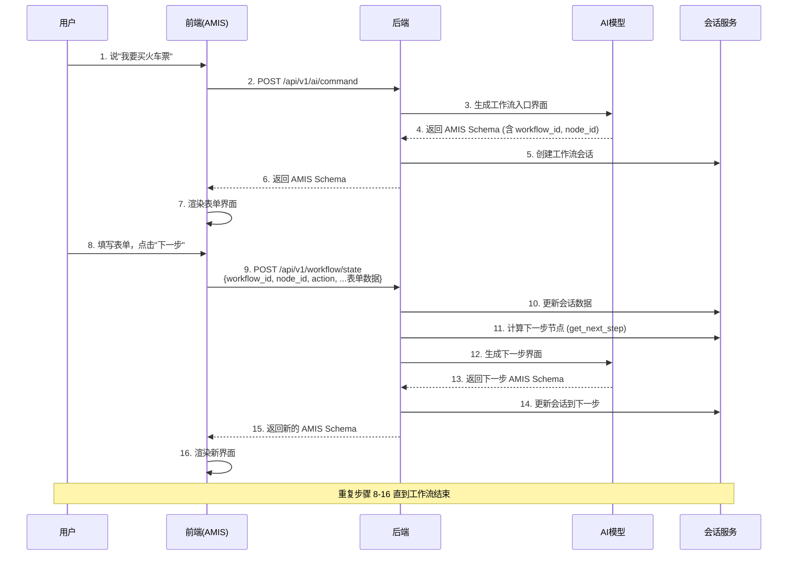
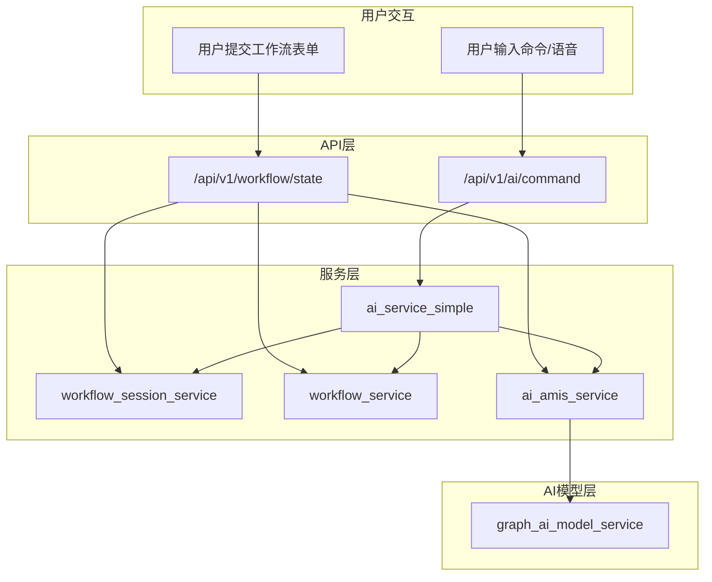
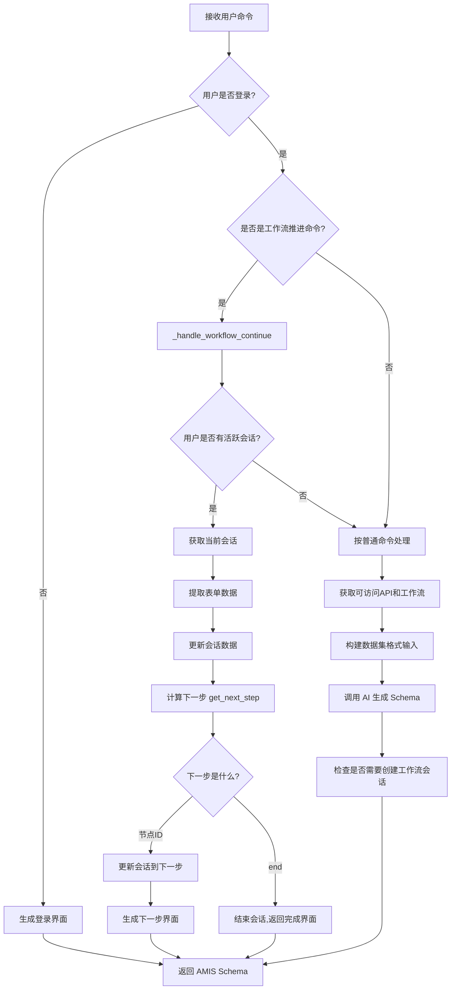
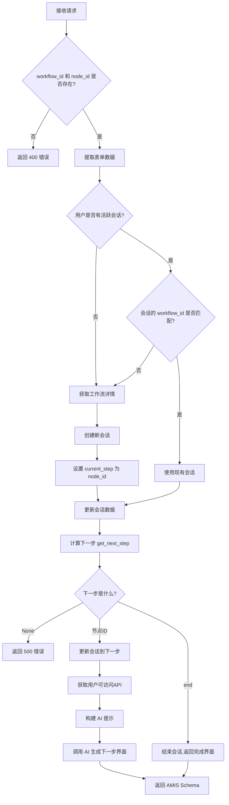
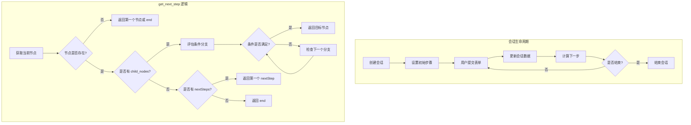

# AILF 工作流处理流程图

## 概述

AILF 系统有两个主要的 API 端点来处理用户请求：
1. `/api/v1/ai/command` - 处理用户的语音/文本命令
2. `/api/v1/workflow/state` - 处理工作流状态转换

## 核心工作流程（用户点击下一步）

当 AI 生成一个工作流界面后，用户点击"下一步"按钮的完整流程：



## 流程图

### 1. 整体架构流程



### 2. `/api/v1/ai/command` 详细流程



### 3. `/api/v1/workflow/state` 详细流程




### 4. 工作流会话管理流程



## 数据流说明

### 请求数据格式

#### `/api/v1/ai/command` 请求
```json
{
    "command": "我要买火车票",
    "context": {
        "business_context": "railway_ticketing",
        "auto_progress": false
    }
}
```

#### `/api/v1/workflow/state` 请求
```json
{
    "workflow_id": "wf_ticket_booking",
    "node_id": "n_select_train",
    "action": "next",
    "departure": "北京",
    "destination": "上海",
    "date": "2025-01-15"
}
```

### 响应数据格式

```json
{
    "status": 0,
    "msg": "success",
    "data": {
        "type": "page",
        "title": "选择车次",
        "body": [
            {
                "type": "form",
                "api": {
                    "method": "POST",
                    "url": "/api/v1/workflow/state",
                    "data": {
                        "workflow_id": "wf_ticket_booking",
                        "node_id": "n_select_train"
                    }
                },
                "body": [...]
            }
        ]
    }
}
```

## AI 生成的表单配置

AI 生成的工作流表单会包含以下关键配置：

```json
{
  "type": "form",
  "title": "选择出发信息",
  "api": {
    "method": "post",
    "url": "/api/v1/workflow/state",
    "data": {
      "workflow_id": "wf_ticket_booking",
      "node_id": "n_select_train",
      "action": "next",
      "&": "$"
    }
  },
  "body": [...表单字段...],
  "actions": [
    {"type": "submit", "label": "下一步", "level": "primary"}
  ]
}
```

关键点：
- `"&": "$"` 是 AMIS 语法，表示把所有表单字段值合并到请求数据中
- `workflow_id` 和 `node_id` 用于后端定位当前工作流和节点
- `action` 指示操作类型（next/submit）

## 注意事项

1. **两个端点的职责不同**：
   - `/api/v1/ai/command`: 处理自然语言命令，可能触发工作流
   - `/api/v1/workflow/state`: 专门处理工作流状态转换（表单提交）

2. **会话管理**：
   - 每个用户同时只能有一个活跃的工作流会话
   - 创建新会话会自动结束旧会话

3. **条件分支**：
   - 支持多种操作符：==, !=, >, <, >=, <=, in, not_in, contains, exists, is_empty 等
   - 条件评估使用累积的表单数据

4. **AI 生成**：
   - 使用图增强大模型生成 AMIS Schema
   - 支持端点验证和修复
   - 必须正确生成 `workflow_id` 和 `node_id`
