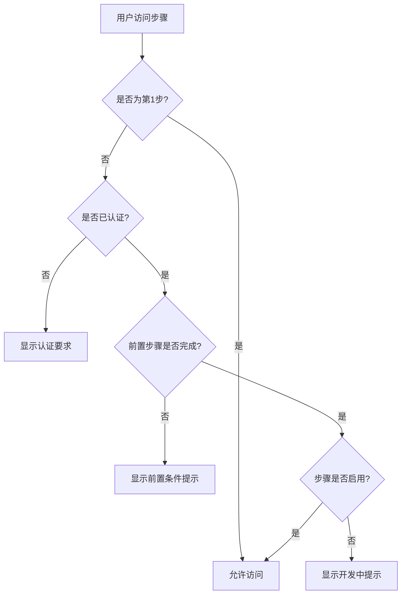

# 前端开发者配置Token管理系统优化

## 📋 概述

本次优化根据API文档规范，统一了前端开发者配置的token管理逻辑，实现了严格的认证控制和权限管理。

## 🎯 优化目标

1. **统一Token管理**：创建统一的TokenManager服务，集中管理token的生命周期
2. **严格权限控制**：实现基于认证状态的步骤访问控制
3. **自动化管理**：支持token自动刷新、过期处理和状态监听
4. **符合API规范**：严格按照API文档的认证流程实现

## 🔧 主要改进

### 1. 统一Token管理服务 (`TokenManager`)

**文件位置**: `frontend/src/services/common/tokenManager.ts`

**核心功能**:
- ✅ Token的安全存储和恢复
- ✅ 自动token刷新（提前5分钟）
- ✅ Token有效性验证
- ✅ 认证状态监听机制
- ✅ 与API客户端的集成

**关键特性**:
```typescript
// 自动刷新配置
const config = {
  storageKey: 'ailf_developer_token',
  autoRefresh: true,
  refreshThreshold: 300 // 提前5分钟刷新
};

// 状态监听
tokenManager.addListener((isAuthenticated) => {
  // 认证状态变化时的处理
});
```

### 2. 增强的API客户端

**文件位置**: `frontend/src/services/common/apiClient.ts`

**新增功能**:
- ✅ 自动token刷新回调
- ✅ 401错误自动重试机制
- ✅ 与TokenManager的深度集成

**核心改进**:
```typescript
// 自动处理token过期
if (response.status === 401 && retryCount === 0) {
  const newToken = await this.refreshTokenIfNeeded();
  if (newToken) {
    return this.request(endpoint, options, retryCount + 1);
  }
}
```

### 3. 重构的认证Hook

**文件位置**: `frontend/src/hooks/developer/useDeveloperAuth.ts`

**优化内容**:
- ✅ 移除重复的本地存储逻辑
- ✅ 集成TokenManager进行状态管理
- ✅ 简化认证流程
- ✅ 实时状态同步

### 4. 严格的访问控制组件

#### AuthGuard组件
**文件位置**: `frontend/src/components/developer/auth/AuthGuard.tsx`

**功能**:
- ✅ 认证状态验证
- ✅ 未认证用户的友好提示
- ✅ 加载状态处理

#### StepAccessControl组件
**文件位置**: `frontend/src/components/developer/auth/StepAccessControl.tsx`

**功能**:
- ✅ 基于前置步骤的访问控制
- ✅ 认证要求检查
- ✅ 步骤完成状态显示
- ✅ 友好的错误提示

### 5. 更新的开发者配置主组件

**文件位置**: `frontend/src/components/developer/DeveloperConfigMain.tsx`

**改进**:
- ✅ 严格的步骤启用逻辑
- ✅ 集成访问控制组件
- ✅ 基于认证状态的UI更新

## 🔒 权限控制逻辑

### 步骤访问规则

1. **第1步（开发者认证）**: 总是可访问
2. **第2步（场景配置）**: 需要完成认证
3. **第3步（模板选择）**: 需要完成场景配置
4. **第4步（实体建模）**: 需要完成模板选择
5. **第5步（API路由管理）**: 需要完成实体建模
6. **第6步（工作流设计）**: 需要完成API路由管理
7. **第7步（角色管理）**: 需要完成工作流设计
8. **第8步（代码生成部署）**: 需要完成角色管理

### 认证检查流程



## 🧪 测试功能

**测试页面**: `/test/token`
**文件位置**: `frontend/src/components/test/TokenManagerTest.tsx`

**测试功能**:
- ✅ 开发者认证测试
- ✅ Token验证测试
- ✅ 自动刷新测试
- ✅ 状态监听测试
- ✅ 存储恢复测试

## 📊 优化效果

### 安全性提升
- ✅ 严格的认证流程控制
- ✅ Token自动过期处理
- ✅ 无效token自动清理
- ✅ 防止未认证访问

### 用户体验改善
- ✅ 自动token刷新，无需重新登录
- ✅ 友好的错误提示和引导
- ✅ 实时认证状态更新
- ✅ 流畅的步骤导航

### 代码质量提升
- ✅ 统一的token管理逻辑
- ✅ 减少代码重复
- ✅ 清晰的职责分离
- ✅ 易于维护和扩展

## 🚀 使用方法

### 1. 开发者认证
```typescript
import { tokenManager } from '../services/common/tokenManager';

// 检查认证状态
const isAuthenticated = tokenManager.isAuthenticated();

// 监听认证状态变化
tokenManager.addListener((isAuthenticated) => {
  console.log('认证状态变化:', isAuthenticated);
});
```

### 2. 保护组件
```typescript
import AuthGuard from '../components/developer/auth/AuthGuard';

<AuthGuard>
  <ProtectedComponent />
</AuthGuard>
```

### 3. 步骤访问控制
```typescript
import StepAccessControl from '../components/developer/auth/StepAccessControl';

<StepAccessControl
  stepId={2}
  stepTitle="场景配置"
  requiresAuth={true}
  completedSteps={[1]}
>
  <StepContent />
</StepAccessControl>
```

## 🔄 后续计划

1. **性能优化**: 实现token预加载和缓存策略
2. **错误处理**: 增强网络错误和服务器错误的处理
3. **监控日志**: 添加认证相关的日志记录
4. **测试覆盖**: 编写单元测试和集成测试

## 📝 注意事项

1. **向后兼容**: 保持与现有API的兼容性
2. **安全考虑**: Token仅存储在内存和localStorage中
3. **错误恢复**: 网络错误时的自动重试机制
4. **用户引导**: 清晰的错误提示和操作指引

---

**优化完成时间**: 2024-01-20
**负责人**: AILF开发团队
**版本**: v2.0.0
